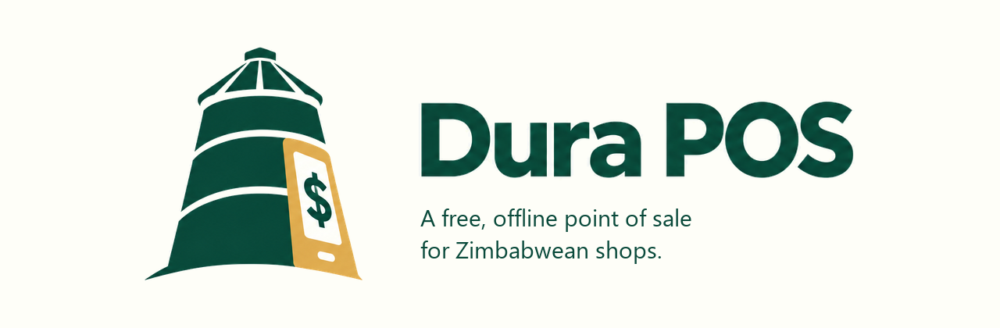
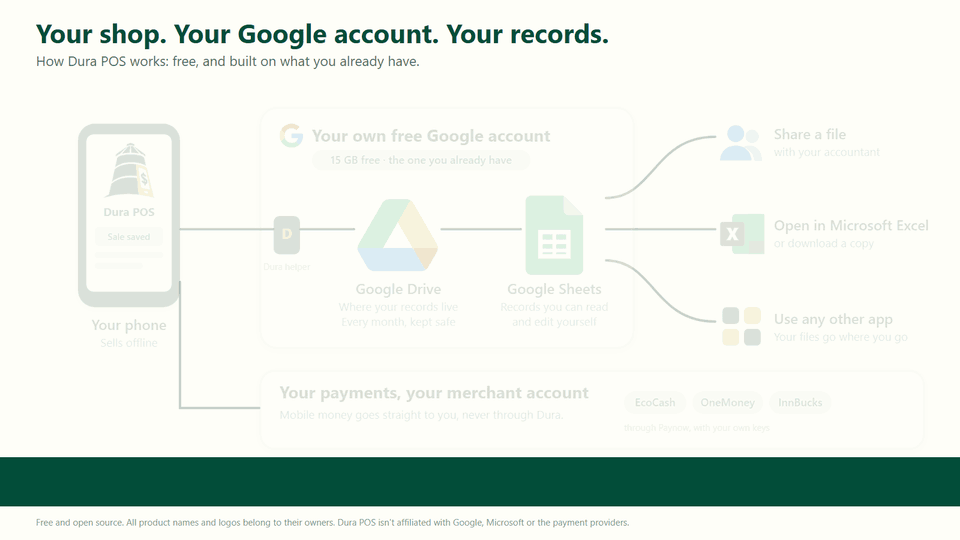
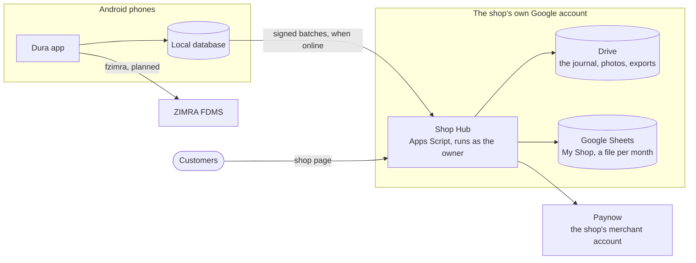
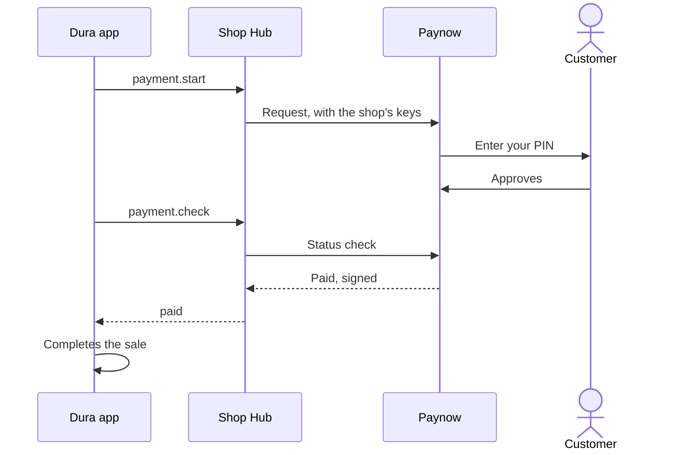
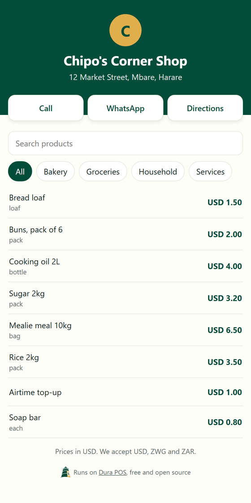

<p align="center">
  
</p>

<p align="center">
  <a href="LICENSE"></a>
  
  
</p>

<p align="center">
  <a href="#how-it-works">How it works</a> ·
  <a href="#where-it-stands">Where it stands</a> ·
  <a href="#get-started">Get started</a> ·
  <a href="handbook/README.md">Handbook</a> ·
  <a href="#contribute">Contribute</a>
</p>

Dura POS is a free, open-source point of sale for street vendors and small shops.
It sells offline on an Android phone, and keeps every record in the owner's own
Google account, as Sheets they can open, edit and take with them.

*Dura* is the Shona word for a granary, where a household stores its harvest. Dura
POS is that store for a shop's sales, stock and money.

The project was born in Zimbabwe, and that's who it serves first: it handles USD, ZWG
and ZAR, and its fiscalisation plans follow ZIMRA. Nothing limits it to one market, so
if it could work for shops where you are, you're welcome here.

<p align="center">
  
</p>

> **Early development: not ready for live trading.** The backend is written and
> tested, and its main path has run on a real Google account. The app has its
> foundation, with no selling screens yet. See [where it stands](#where-it-stands).

## Why Dura

Commercial point-of-sale systems serve many businesses well, with support and
hardware behind them. Dura is another option, for the smallest shops that want to run
things themselves, at no cost, in an account they already own:

| Dura's promise | What it means |
|---|---|
| **Free, with no Dura server** | The app is free and open source. Everything shared lives in the shop's own Google account |
| **The records belong to the shop** | Ordinary Sheets the owner or accountant can read, edit, export to Excel, or leave with |
| **Selling never waits** | A sale is saved on the phone first and uploaded when there's a connection. Nothing optional can stop a cash sale |
| **The shop's own keys** | Mobile money and tax systems use the shop's own accounts, so payments go straight to the business |
| **Honest numbers** | Amounts always show their currency, and currencies are never added together |
| **Built for how small shops trade** | Several currencies, the owner's own pricing currency, change kept for customers, credit for regulars, expenses from the till |

It's for street vendors, market traders, tuck shops and small shops, from one phone
to about ten. Businesses that want help with setup, migration or a custom
integration can pay for that work; the app stays free.

## How it works



- **The phone sells** from its own database, with or without a connection.
- **The journal is the history.** Each phone uploads an append-only record of what
  happened. Events are never rewritten; a correction is a new linked event.
- **Sheets are built from the journal,** so a damaged sheet can be rebuilt. Tabs the
  owner edits, such as prices, are checked before they're accepted.
- **The Shop Hub is the shop's own backend:** an Apps Script web app in the owner's
  account. All its usage counts against that account, not Dura's
  ([decision 0005](handbook/decisions/0005-shop-hub-as-the-backend.md)).
- **Phones pair by QR code,** sign every request, and never hold a Google sign-in.
- **The app is server-agnostic.** It reaches any backend through one port, so leaving
  Google means one new adapter, not a new app.
- **Workbooks start as Excel templates,** so they work in Sheets and in Excel.

### Mobile money

The hub calls Paynow with the shop's own keys, which never reach a phone. A payment
counts as paid only when Paynow's status check says so, and a charge is never
repeated. [How payments work](handbook/engineering/11-payments.md) has the full
flows.



### A page for every shop

The hub's address doubles as a free one-page shop page, with the shop's contacts and
a searchable price list that stays quick however many products a shop has. It shows
only what's meant to be public, and the owner can turn it off ([decision 0009](handbook/decisions/0009-shop-page.md)).

<p align="center">
  
</p>
<p align="center"><sub>Rendered with sample data.</sub></p>

## Where it stands

| Part | State |
|---|---|
| Workbook generator | Built: a complete sample shop, and clean templates for each pricing currency |
| Shop Hub | Written and tested: pairing, journal, shop setup, Sheets views, timers, Paynow, photos, exports, shop page. The [first run on a real Google account](handbook/engineering/10-real-account-test.md#results-of-the-first-run) passed for install, setup, uploads, views, photos and exports. **Timers and Paynow's sandbox are still to try** |
| App foundation | Built: Flutter workspace, shared UI, local storage, on-device diagnostics, money types |
| Backend port and hub adapter | Built and tested against a live hub, with no screens using them yet |
| Selling screens, hub install | Next |
| Staff, stock, reports | [Designed](handbook/product/02-capabilities.md) |
| ZIMRA fiscalisation | Planned, through [fzimra](https://github.com/DonnC/zimra-fdms-android), and optional for each business |

The [capability map](handbook/product/02-capabilities.md) tracks every feature, and
the [roadmap](handbook/engineering/06-roadmap.md) shows the order of work.

## Get started

### See the sample shop

[`backend/templates/sample/Dura POS/`](backend/templates/sample) is a complete
fictional shop: every workbook, tab, dropdown, formula and chart Dura is designed
to create. Open the `.xlsx` files in Excel or Google Sheets. There's nothing to
install.

### Run the app

You'll need Flutter 3.47.9 (pinned in
[`client/.flutter-version`](client/.flutter-version)), the Android SDK, Java 17, and
a device or emulator. No Google account is needed yet.

```sh
cd client
flutter pub get
dart run melos bootstrap
dart run melos run verify      # formatting, policy checks, analysis and tests
cd apps/dura
flutter run
```

The current build opens the foundation screen and diagnostic settings.

### Test the hub

You'll need Node 22 or later.

```sh
cd backend/hub
npm ci
npm run verify                 # type check, then every test
```

To try it on a real Google account, `npm run trial` installs a hub, runs every check
and writes a report. The [real-account test](handbook/engineering/10-real-account-test.md)
explains what it needs.

### Change a workbook

You'll need Python 3.11 or later. Change the generator, never a workbook:

```sh
cd backend/templates
python -m pip install -r requirements.txt
python -m dura_templates sample    # rebuild the sample shop
python -m dura_templates verify    # it reconciles, and every formula works in Excel
```

See [the generator's README](backend/templates/README.md) for every command.

## Project structure

```text
dura-pos/
├── client/                 Flutter workspace (Melos)
│   ├── apps/dura/          the Android app
│   └── packages/
│       ├── dura_core/      business rules in pure Dart
│       ├── dura_data/      local storage and diagnostics
│       ├── dura_hub/       the Shop Hub adapter, behind the backend port
│       └── dura_ui/        theme and shared components
├── backend/                runs in, or is created in, the shop's Google account
│   ├── hub/                Shop Hub (Apps Script, JavaScript)
│   └── templates/          workbook generator, checks and sample shop (Python)
├── data/                   ZIMRA HS code list
├── handbook/               vision, engineering rules, decisions, design
├── notes/                  design notes from the research phase
└── research/               original research conversations
```

## Documentation

- [Handbook](handbook/README.md): start here. It maps everything else.
- [Vision](handbook/product/01-vision.md): the problem, the users and the reasons.
- [Experience principles](handbook/product/03-experience-principles.md): how screens
  and sheets should behave.
- [Architecture](handbook/engineering/01-architecture.md) and
  [hub protocol](backend/hub/PROTOCOL.md).
- [Payments](handbook/engineering/11-payments.md).
- [Glossary](handbook/product/04-glossary.md).

## Contribute

Contributions are welcome: code, tests, design, spreadsheet and accounting review,
translation into Shona or Ndebele, and feedback from people who run shops. Read
[CONTRIBUTING](CONTRIBUTING.md) to start, and follow the
[Code of Conduct](CODE_OF_CONDUCT.md). If you work with an AI assistant, the project's
skills are in [`.agents/skills/`](.agents/skills); start with `dura-project`.

Please don't post PINs, keys, tokens or real customer data in issues. Report security
problems as described in [SECURITY](SECURITY.md). For help, see [SUPPORT](SUPPORT.md).

## Licence and credits

- Released under the [MIT licence](LICENSE). See [AUTHORS](AUTHORS) and
  [third-party notices](THIRD_PARTY_NOTICES.md).
- ZIMRA fiscalisation will use
  [fzimra](https://github.com/DonnC/zimra-fdms-android), which builds on Shaun
  Chivandire's original TypeScript `zimra-fdms` SDK.
- Dura POS is not certified by ZIMRA.
