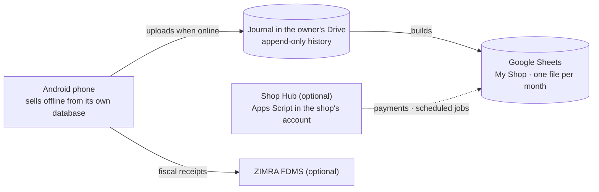

<!--
Copyright (c) 2026, DonnC & contributors.
Please see the AUTHORS file for details. All rights reserved.
Use of this source code is governed by the MIT license that can be
found in the LICENSE file at the repository root.
SPDX-License-Identifier: MIT
-->

# Dura POS

**A free, open-source point of sale for Zimbabwean vendors and small shops. It
works offline and keeps every record in the shop's own Google Drive.**

*Dura* is Shona for a granary, the place a household keeps its harvest. Dura
POS keeps a shop's sales, stock and money in a store the shop owns.

> **Status: early foundation. It doesn't sell yet.** The Flutter workspace,
> shared UI, local storage and diagnostics exist. Selling, sync, staff,
> payments and ZIMRA fiscalisation are designed but not built. Don't use it
> for live trading. See [where it is](#where-it-is-and-where-its-going).

## Why Dura

Most point-of-sale systems in Zimbabwe are rented by the month and keep the
shop's data on someone else's server. Small traders don't want to pay that,
and when they stop paying they lose the records. Dura takes a different
approach:

- **Free, with no vendor cloud.** There is no Dura server. The records live in
  the owner's own Google account, which comes with 15 GB free.
- **The records are the shop's.** They're Google Sheets the owner and their
  accountant can open, read, export to Excel, and take elsewhere.
- **Selling never waits for the network.** Every sale is saved on the phone
  first and uploads when there's signal.
- **Made for how Zimbabwe trades:**
  - USD, ZWG and ZAR, with the owner choosing the pricing currency;
  - "kept change" when the till has no coins;
  - credit for regulars;
  - expenses paid straight out of the till.
- **The shop's own keys.** ZIMRA fiscalisation and mobile money (Paynow, ZB
  Smile&Pay) are optional, and use the business's own credentials. Money goes
  straight to the business.
- **Simple enough for anyone.** No screen should need more than five seconds
  of thought.

It's for a street vendor with one phone, up to a shop with about ten phones.
It isn't for chains.

## How it works



- **The phone** sells from its own database.
- **The journal** in the owner's Drive is the shared history. Every event has
  an ID, so a retried upload never counts twice.
- **Google Sheets** are built from the journal for people:
  - a Read Me in every file;
  - dropdowns and colour-coded tabs;
  - charts.
- **The optional Shop Hub** holds payment keys and receives payment callbacks.
  It's never needed to finish a cash sale.
- **Fiscalisation** runs on the phone through
  [fzimra](https://github.com/DonnC/zimra-fdms-android).

The reasons behind each choice are in the [vision](handbook/product/01-vision.md#why-its-built-this-way).

## Where it is, and where it's going

| Phase | What it delivers | Status |
|---|---|---|
| 0 | Spikes: Google Drive permissions, Sheets timing, the hub install, questions to ZIMRA | Not started |
| 1 | Workspace, CI, shared UI, local storage, diagnostics | **Foundation done** |
| 2 | One phone sells: products, pricing currency, cash sales, receipts, restart safety | Next |
| 3 | Owner records: journal upload, Sheets views, backup, restore, Excel and CSV export | Designed |
| 4 | Staff and shifts: PINs, roles, cash-up, handover | Designed |
| 5 | ZIMRA fiscalisation (optional) | Designed; waits on ZIMRA's answers |
| 6 | Shop Hub, several phones, mobile money | Designed |
| 7 | Stock, suppliers, credit, reports, then a pilot with real shops | Designed |
| 8 | Owner view on desktop and web | Later |

Feature by feature: the [capability map](handbook/product/02-capabilities.md).
Exit criteria per phase: the [roadmap](handbook/engineering/06-roadmap.md).

## Try the design today

There's no app to sell with yet, but you can explore the design:

- **A complete sample shop** in [`samples/Dura POS/`](samples/): every
  workbook, tab, dropdown, formula and chart Dura will create, for a fictional
  shop. Open the `.xlsx` files in Excel or Google Sheets.
- **An interactive mock-up** of the first screens:
  [`handbook/design/prototype/dura-mobile-preview.html`](handbook/design/prototype/).
  Open it in a browser.

## Build the foundation

You'll need:

- Flutter **3.47.9** (Dart 3.13.7), pinned in `client/.flutter-version`;
- the Android SDK and Java 17;
- an Android device or emulator.

No Google account, merchant keys or ZIMRA credentials are needed.

```sh
cd client
flutter pub get
dart run melos bootstrap
dart run melos run verify      # format, policy checks, analysis, all tests
cd apps/dura
flutter run
```

Only Android is set up so far. The app opens a foundation screen with
diagnostic settings.

To regenerate and check the sample shop (needs Python 3 and `openpyxl`):

```sh
cd samples
python3 generate_samples.py
python3 check_samples.py "Dura POS"
python3 check_formulas.py "Dura POS"
```

## Repository map

| Where | What |
|---|---|
| [`handbook/`](handbook/README.md) | **Start here.** Vision, capabilities, experience principles, glossary, engineering rules and decisions |
| [`client/`](client/) | All Flutter code: the app (`apps/dura`) and packages `dura_core` (pure Dart rules), `dura_data` (storage), `dura_ui` (theme and components) |
| [`samples/`](samples/) | The executable spec: a generator for the sample shop, plus checks that its numbers add up |
| [`schema/`](schema/PLAN.md) | The workbook template and compatibility plan |
| [`hub/`](hub/PLAN.md) | The future Shop Hub (Apps Script) |
| [`notes/`](notes/README.md) | Numbered design notes: the detailed reasoning |
| [`research/`](research/README.md) | The original research conversations; historical |
| [`reference/`](reference/) | ZIMRA's HS code list |
| [`.agents/skills/`](.agents/skills/) | Project workflows for AI coding assistants |

## Contributing

Contributions are welcome, from code and tests to design, translation into
Shona or Ndebele, and testing with real vendors.

- Read [CONTRIBUTING](CONTRIBUTING.md) for the workflow, and the
  [handbook](handbook/README.md) for the design.
- Good first steps:
  - review a design note;
  - improve the sample shop;
  - pick up a Phase 2 task from the [roadmap](handbook/engineering/06-roadmap.md).
- Be kind: [Code of Conduct](CODE_OF_CONDUCT.md).

Never post PINs, keys, tokens or real customer records in an issue. For
security problems, see [SECURITY](SECURITY.md). For help running Dura, see
[SUPPORT](SUPPORT.md).

## Credits and licence

- Original Dura POS work is [MIT](LICENSE) licensed. Third-party licences are
  in [THIRD_PARTY_NOTICES](THIRD_PARTY_NOTICES.md). Authors are listed in
  [AUTHORS](AUTHORS).
- ZIMRA fiscalisation builds on
  [fzimra](https://github.com/DonnC/zimra-fdms-android), and on the original
  TypeScript `zimra-fdms` SDK by Shaun Chivandire.
- Dura POS is not certified or approved by ZIMRA.
