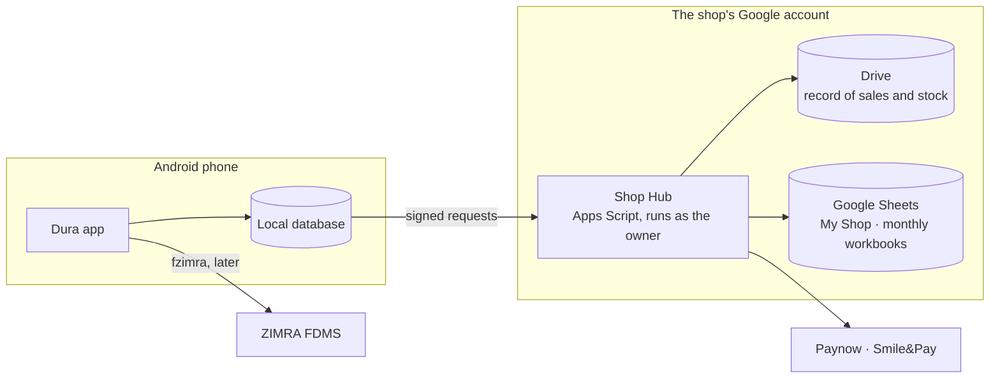

<!--
Copyright (c) 2026, DonnC & contributors.
Please see the AUTHORS file for details. All rights reserved.
Use of this source code is governed by the MIT license that can be
found in the LICENSE file at the repository root.
SPDX-License-Identifier: MIT
-->

# Dura POS

A free, open-source point of sale for Zimbabwean vendors and small shops. It
sells offline and keeps the shop's records in the owner's own Google account.

*Dura* is the Shona word for a granary, where a household stores its harvest.
Dura POS is that store for a shop's sales, stock and money.

> **Status: early development.** The app foundation is in place: the Flutter
> workspace, shared UI components, local storage, on-device diagnostics and CI.
> Selling, sync, staff, payments and fiscalisation are designed and next on
> the [roadmap](handbook/engineering/06-roadmap.md). It isn't ready for live
> trading yet.

## Why Dura

Point-of-sale systems sold in Zimbabwe usually come with a monthly or yearly
fee, and keep the shop's data on the vendor's servers. Small traders often
don't want to pay that, and when they stop paying they can lose access to
their own records.

Dura takes a different approach:

- **No subscription and no Dura server.** The app is free and open source.
  Records live in the business's own Google Drive, using the Google services
  that come with its account.
- **The records belong to the shop.** They're ordinary Google Sheets that the
  owner or their accountant can open, edit, export to Excel, or take to
  another system.
- **Offline first.** A sale is saved on the phone first, and uploaded when
  there's a connection.
- **Built for local trading:**
  - USD, ZWG and ZAR, with the owner choosing the pricing currency;
  - change owed to a customer when the till runs short;
  - credit for regular customers;
  - expenses paid from the till.
- **The business's own accounts.** Mobile money and ZIMRA fiscalisation use
  the shop's own merchant and ZIMRA credentials. Payments go straight to the
  business.

Dura is for street vendors, market traders, tuck shops and small shops, from
one phone up to about ten. Businesses that want help with setup, migration or
a custom integration can pay for that work; the app stays free.

## Planned features

| Area | What's planned |
|---|---|
| Selling | Products and services, barcode scanning, cash and split payments in several currencies, change, receipts (share or Bluetooth print), returns and refunds |
| Stock | Stock movements, receiving, counts, losses, low-stock alerts, suppliers and purchases with invoice photos |
| Money | Cash-ups per shift and currency, expenses by category, owner drawings, kept change, customer credit and invoices, quotes |
| People | Owner, manager and seller roles with PINs; several phones; several locations |
| Records | Google Sheets workbooks with a Read Me, dropdowns, colour-coded tabs and charts; Excel and CSV export; backup and restore |
| Payments | Paynow and ZB Smile&Pay through the optional Shop Hub, plus manual payment references |
| Fiscalisation | ZIMRA fiscal receipts on the phone through [fzimra](https://github.com/DonnC/zimra-fdms-android); optional, per business |
| Training | Practice mode with a fictional shop, and a test mode kept separate from live data |

The [capability map](handbook/product/02-capabilities.md) tracks the status of
each feature.

## How it works



- **The phone does the selling** from its own database, with or without a
  connection.
- **The Shop Hub is the shop's own backend.** It's an Apps Script web app
  that the app installs in the owner's Google account, and it runs as the
  owner. It does the work that reaches Google:
  - stores each phone's append-only record of sales, payments and stock
    changes in Drive;
  - builds the readable Sheets from that record, so a damaged sheet can be
    rebuilt;
  - holds payment keys and receives provider callbacks;
  - runs scheduled jobs, such as preparing next month's file.

  Its usage counts against the shop's account, not Dura's
  ([decision 0005](handbook/decisions/0005-shop-hub-as-the-backend.md)).
- **Phones pair with the hub by QR code.** They sign every request with their
  own secret, and never hold a Google sign-in.
- **Workbooks start from Excel templates.** A Python generator produces them
  for each release. The hub checks them and converts them into Google Sheets
  in the shop's Drive.
- **The app is server-agnostic.** It talks to one backend port. The hub is
  the first implementation; another backend would mean a new adapter, not a
  new app.
- **Fiscalisation** will use fzimra, which runs on the phone and talks to
  ZIMRA directly. Each business completes ZIMRA's tests before moving from
  the test environment to production.

## Getting started

### Run the app

You'll need:

- Flutter 3.47.9 (pinned in [`client/.flutter-version`](client/.flutter-version));
- the Android SDK and Java 17;
- an Android device or emulator.

No Google account or credentials are needed yet.

```sh
cd client
flutter pub get
dart run melos bootstrap
dart run melos run verify      # formatting, policy checks, analysis and tests
cd apps/dura
flutter run
```

The current build opens the foundation screen and diagnostic settings.

### Explore the sample shop

[`backend/templates/sample/Dura POS/`](backend/templates/) holds a complete fictional shop: every
workbook, tab, dropdown, formula and chart Dura is designed to create. Open
the `.xlsx` files in Excel or Google Sheets.

The generator is only needed when the workbook layout changes. It needs
Python 3.11 or later:

```sh
cd backend/templates
python -m pip install -r requirements.txt
python -m dura_templates sample    # rebuild the sample shop
python -m dura_templates verify    # it reconciles, and every formula works in Excel
```

Every template must work in Google Sheets and in Excel 2019 or later; the
`excel` check enforces that. See [the generator's README](backend/templates/README.md)
for all commands.

## Project structure

```text
dura-pos/
├── client/                 Flutter workspace (Melos)
│   ├── apps/dura/          the Android app
│   └── packages/
│       ├── dura_core/      business rules in pure Dart
│       ├── dura_data/      local storage and diagnostics
│       └── dura_ui/        theme and shared components
├── backend/                runs in, or is created in, the shop's Google account
│   ├── hub/                Shop Hub (Apps Script, JavaScript)
│   └── templates/          workbook generator, checks and sample shop (Python)
├── data/                   shared reference data: ZIMRA HS code list
├── handbook/               product vision, engineering rules, decisions, design
├── notes/                  design notes from the research phase
└── research/               original research conversations
```

## Documentation

- [Handbook](handbook/README.md): start here. It links everything below.
- [Vision](handbook/product/01-vision.md): the problem, the users, and the
  reasons behind each design choice.
- [Experience principles](handbook/product/03-experience-principles.md): how
  screens and sheets should behave.
- [Architecture](handbook/engineering/01-architecture.md) and
  [roadmap](handbook/engineering/06-roadmap.md).
- [Glossary](handbook/product/04-glossary.md).

## Contributing

Contributions are welcome: code, tests, design, spreadsheet and accounting
review, translation into Shona or Ndebele, and feedback from people who run
shops. Read [CONTRIBUTING](CONTRIBUTING.md) to get started, and follow the
[Code of Conduct](CODE_OF_CONDUCT.md).

Please don't post PINs, keys, tokens or real customer data in issues. Report
security problems as described in [SECURITY](SECURITY.md). For help, see
[SUPPORT](SUPPORT.md).

## Licence and credits

- Dura POS is released under the [MIT licence](LICENSE). See
  [AUTHORS](AUTHORS) and [third-party notices](THIRD_PARTY_NOTICES.md).
- ZIMRA fiscalisation will use
  [fzimra](https://github.com/DonnC/zimra-fdms-android), which builds on
  Shaun Chivandire's original TypeScript `zimra-fdms` SDK.
- Dura POS is not certified by ZIMRA.
