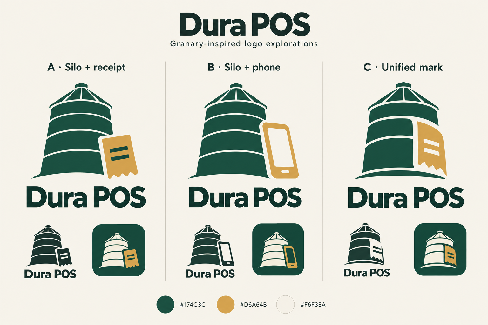

# Dura POS logo directions

> Historical exploration. On 10 November 2026 the owner replaced this direction
> with [The Shop Sign](04-shop-sign.md), recorded in decision 0011. The artwork
> and earlier selection below are retained as history.

2 November 2026. Early concept exploration; no direction is approved yet.

> Subsequent selection: the owner chose the unified tapered silo/phone direction
> and requested a dollar sign in the phone screen. See
> `dura-silo-phone-dollar-v3.png`. The original comparison remains below for
> history; production vector/store assets are still to be prepared. The symbol
> does not change the owner's choice of pricing currency.

## Preview

The board explores the requested low-angle silo: a broad base, sides gently
converging upwards, and a visible conical roof. These are raster concepts, not
production vector masters or store-ready exports.

| Direction | What it shows | Strength | Concern |
|---|---|---|---|
| A: Silo + receipt | Separate receipt overlapping a silo | Clearest relationship between storage and transactions | More elements to preserve at small sizes |
| B: Silo + phone | A recognisable phone beside a silo | Closest to the initial mobile application idea | Generic phone symbol; less platform-neutral as desktop/web arrive |
| C: Unified mark | Receipt integrated into the silo's right side | Compact starting point for app icon and repository identity | Needs refinement so the receipt remains recognisable in one colour |

Recommendation: refine C, using A as the clarity reference. Preserve the
slight upward perspective without making the silo resemble a cooling tower.
Reduce roof struts and horizontal bands if necessary. Treat the receipt as a
simple silhouette, with few broad marks. Never rely on tiny printed text.

## Colour proposal

| Role | Colour | Reason |
|---|---|---|
| Primary | Evergreen `#174C3C` | A grounded visual association with stored produce; usable as a dark brand surface and prominent action colour |
| Accent | Grain gold `#D6A64B` | Connects the receipt detail to the granary idea and adds warmth |
| Light surface | Warm ivory `#F6F3EA` | Softer supporting background for previews and marketing |
| Text | Ink `#182D27` | Strong dark text on light surfaces |

These associations are design reasoning, not evidence of a particular customer
reaction. Green is common in finance and agriculture; the silhouette and
wordmark must distinguish Dura. Gold is an accent, not a default small-text
colour on a light background. Check actual UI contrast and interaction states
before committing the application theme. Keep success/warning/error meanings
clear without relying on colour alone.

## Required next checks

- Redraw the selected direction as editable vector artwork.
- Remove generated texture and inconsistent line treatment.
- Inspect at 24, 32, 48, and 64 px, in colour and one colour.
- Check circular and rounded-square icon masks and safe margins.
- Test recognition: silo/granary plus commerce, not an agriculture-only service.
- Confirm the wordmark spelling/style and check similarity to existing marks.
- Produce store assets only after the direction is selected.

## Subsequent asset family

Primary symbol; horizontal and stacked Dura POS wordmarks; one-colour and
reversed versions; Google Play listing icon; Android adaptive foreground,
background and monochrome layers; store feature graphic; mobile screenshot
templates; repository header/social preview; square avatar; favicon and web
icons; splash-screen symbol. iOS assets can follow the selected platform's
current requirements when that application is planned.

Google Play listing icon: 512 × 512 px, 32-bit PNG, sRGB, at most 1024 KB;
full-square asset without baked-in rounded outer corners or external shadow.
Launcher icons are separate assets. Android adaptive layers use 108 × 108 dp
with essential artwork inside the 66 × 66 dp safe area.

Sources checked 2 November 2026:

- https://developer.android.com/distribute/google-play/resources/icon-design-specifications
- https://developer.android.com/develop/ui/compose/system/icon_design_adaptive

Generation method: built-in image-generation tool. The exact generation prompt
is saved in `logo-exploration-prompt.txt`. The board includes mock icon shapes
for discussion; they are not the final store exports.
