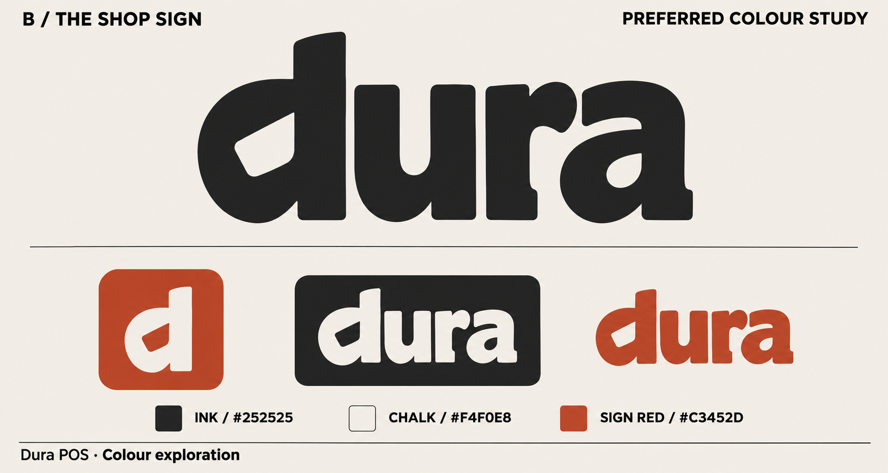

# Dura / The Shop Sign

Approved by the owner on 10 November 2026. This is the current identity;
[decision 0011](../../decisions/0011-shop-sign-identity.md) records its scope.



The custom lowercase wordmark's d, with its angled counter, is the compact
mark. Use the supplied paths rather than a substitute font. The phone, silo
illustration and dollar sign are retired from the app and `cdx` design identity.

| Role | Colour | Use |
|---|---|---|
| Ink | `#252525` | Wordmark, text and neutral summaries |
| Chalk | `#F4F0E8` | Header, supporting surfaces and light lettering |
| Sign red | `#C3452D` | Main actions, selected borders and small accents |
| Paper | `#FFFFFF` | Work surfaces and primary-button text |

Colour does not replace words. Red primary buttons are actions; errors have
explicit messages and separate burgundy tokens. Dark mode uses charcoal
surfaces, chalk text and light coral links. Buttons retain red/white.

## Source assets and regeneration

Masters and build inputs live in `client/apps/dura/assets/branding/`:

- `shop-sign-wordmark.svg`: transparent charcoal wordmark.
- `shop-sign-mark.svg`: transparent charcoal d.
- `shop-sign-launcher.svg`: square red field and white d for legacy icons.
- `shop-sign-foreground.svg`: transparent, smaller white d for adaptive masks.
- `launcher-source.png`: 1024 px export of the legacy master.
- `launcher-foreground.png`: 1024 px RGBA export of the adaptive master.

Path geometry follows the large wordmark in the selected colour study. PNG
sources are exports of the SVG masters, without headings, baked shadows,
rounded outer corners or textures. The adaptive mark is inset further than
the legacy mark to stay within the centred 66 dp safe circle on a 108 dp layer.
The transparent foreground supports themed icons, following the
[Android adaptive-icon guidance](https://developer.android.com/develop/ui/compose/system/icon_design_adaptive).

After exporting updated SVG icon masters to their 1024 px PNG counterparts,
run from `client/`:

```sh
dart run tool/generate_launcher_icons.dart
dart test test/launcher_assets_test.dart
```

The locked Dart image dependency regenerates five legacy sizes, the 432 px
adaptive foreground, monochrome reference, splash image and colour resources.
Source PNGs are the committed build inputs. An SVG renderer is needed only
when the approved geometry changes; it is not a new app dependency.

## Design and app use

The [owner/seller prototype](../prototype/cdx/-cdx-preview.html) uses these
assets across all journeys and the older entry point. Product silhouettes
remain, with neutral/red pack labels. Workflows, money and saved state remain.

Flutter uses central `DuraPalette` / `DuraTheme` tokens, with no widget-level
colour values or new screens. Android launcher and splash use the d. Existing
Roboto remains the app font; the wordmark is artwork, not a font dependency.

Tests check brand roles and 4.5:1 text contrast, icon densities, transparency,
monochrome wiring and safe-circle containment. Visual review covers controls
in light/dark at normal/doubled text and the prototype's narrow layouts.
Physical-device masks, caching and startup transitions remain unverified.
No business-record format, migration or restore behaviour changes.

## Verification — 10 November 2026

- `dart run melos run verify`: passed on pinned Flutter 3.47.9 / Dart 3.13.7.
  Includes formatting, repository policy, analysis and all workspace tests.
- Brand-role and text-contrast tests were first run against the previous
  theme and failed, then passed with Shop Sign colours. Icon checks likewise
  detected the former green/opaque artwork before regeneration and now pass.
- All four light/dark control goldens at 1×/2× text were regenerated after
  inspecting before, after and diff renders; subsequent comparisons passed.
- `node handbook/design/prototype/cdx/-cdx-check.cjs`: passed both workflow
  suites and 342 layout combinations; all 12 captures regenerated and reviewed.
- The older `check-mobile-concept.cjs` passed its interaction and
  320/390/736 px checks with the rebranded embedded preview.
- `.agents/sync_skills.py --check`: 10 skills, zero problems.
- Android build-tools 36 AAPT2 compiled and linked every app resource against
  Android 36 using an isolated test manifest. This validates resources only.
- `flutter build apk --debug --no-pub` failed at Gradle with the previously
  documented host error `java.io.IOException: Unable to establish loopback
  connection`. No new APK, install or device run is claimed.

[App icon and mask review](shop-sign/icon-preview.html) shows the source assets
and generated density sizes. The actual app's screen, controller, data/core/hub
code and dependency lockfile have no changes in this work.
