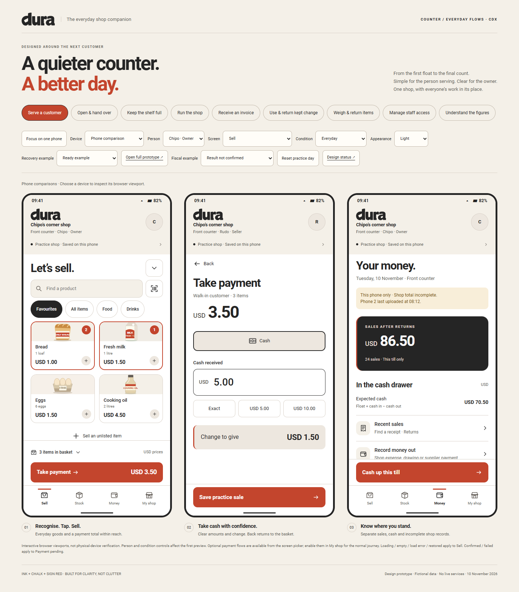

# Dura / Counter — the everyday shop

10 November 2026. Design prototype, based on Dura’s current product contract.
The owner-approved B / Shop Sign identity now covers these screens. Shared
brand masters, actual app colours and Android icon/splash are updated under
`client/`; app workflows, backend and record formats remain unchanged.

[Open the interactive review board](-cdx-preview.html) or
[open one phone](-cdx-counter.html). Start with the five journey buttons above
the phones. The **Person** and **Screen** controls let you inspect individual
owner and worker screens. **Focus on one phone** makes that review easier.

The **Device** selector now includes phone, small phone, tablet portrait and
tablet landscape. See [responsive feature details](-cdx-responsive-design.md)
and the maintained [task status](status.md) for this design-only continuation.

## The design decision

Keep the visual direction, finish the workday. The shop owner and the person
serving customers share a tool, but need different information and authority.

- The **owner** can sell, check the day, receive stock, change prices, pay
  expenses and suppliers, collect customer balances and manage access.
- The **seller** gets selling, stock visibility, their own till, their own
  receipts and owner-approved expenses/returns. No shop exports, staff
  administration or shop-wide financial information appear in that view.
- **The phone holds a drawer; the person takes responsibility for it.** A lock
  keeps the same responsibility. A handover closes a counted shift and starts
  another person with an opening count. Changing the screen’s role in the
  review controls is deliberately outside this product journey.

This is a design hypothesis, not a measured usability result. It has not been
benchmarked against OTS or tested with vendors yet.

## Walk through a normal day

| Moment | Owner’s question | Worker’s action | Screens |
|---|---|---|---|
| Opening | Who has the drawer? | Count starting cash; open with zero if there is no float | Opening → Sell |
| Serving | Are prices clear? | Find goods, correct quantity, take cash, give change | Sell → Basket → Payment → Saved → Next customer |
| A queue forms | Can the next person be served? | Hold a basket; resume without replacing a current basket | Sale options → Held sales |
| An unusual sale | Can I charge for something not listed? | Enter a name and price for one unlisted item | Unlisted item → Basket |
| A return | Who approved money leaving? | Find original receipt; select reason; obtain owner approval | Recent sales → Receipt → Return → Approval → Saved |
| A delivery | What actually arrived? | Owner counts selling packs and reviews the new stock | Stock → Receive → Review → Saved |
| A shelf check | Where did stock go? | Owner enters counts; blank is uncounted, zero is none | Stock count → Differences → Reason → Saved |
| Money leaves | Why is cash lower than sales? | Enter expense; owner approves it | Money out → Review / PIN → Saved |
| A regular pays | Is their balance now right? | Owner records cash against an existing account | Customers → Payment → Review → Saved |
| Closing | Does the cash balance? | Count before seeing expected amounts; explain a difference | Cash count → Review → Close → Handover |
| Next shift | How much cash stays behind? | Identify the next person; count the retained float | Handover → Next person → Opening |

The single main action remains at the bottom; the work area scrolls. Back from
delivery, expense, return and stock-count reviews retains the previous entries.
No confirmation dialog is used for ordinary quantity changes. Removing an item
or clearing a basket offers Undo. Held sales and unresolved payments cannot
silently overwrite the current basket.

## What each person sees

| Area | Owner | Seller |
|---|---|---|
| Bottom navigation | Sell / Stock / Money / My shop | Sell / Stock / My till / Me |
| Sales | This till’s latest receipts | Own receipts on this till |
| Stock | Low stock, details, receive, count, add/edit | Stock visibility and product details |
| Money | Till cash, receipts, expenses, customers, suppliers, summary | Own shift, drawer, receipts, approved expense, cash-up |
| People | Owner and seller access; allowed phone; pairing preview | Current person, lock and handover |
| Records | Export preview, restore checks, connection status | Saved/upload status relevant to the till |
| Returns | Owner approval PIN | Ask owner to enter approval PIN |

Owner-only screen entry shows a clear access screen in the seller preview.
This is browser navigation design, **not production security**. Review controls
can select any role; the sample PIN is printed for training. Production must
enforce permissions in controllers and the hub, protect PINs, rate-limit failed
attempts and enforce offline-access policy. This prototype stores no entered PIN.
Manager-specific permissions and multiple-location administration are outside
this owner/seller design pass.

## Money stays understandable

**Sales, payments and cash are separate.** The owner’s seeded day starts at
USD 86.50 sales, 24 sales and USD 70.50 expected cash. The cash seed reconciles:
USD 10.00 opening float + USD 72.00 received − USD 8.50 change − USD 3.00 expenses.
The seller’s separate example starts at USD 25.50 sales, eight sales and
USD 20.50 cash. These are example summaries, not reconstructed from the single
seeded receipt in Recent sales. New actions update the appropriate counters.

| Sample operation | Sales effect | Drawer effect | Other effect |
|---|---|---|---|
| 2 loaves + 1 milk, receive USD 5.00 | + USD 3.50 | + USD 3.50 | Give USD 1.50 change; decrement stock |
| USD 2.00 expense | None | − USD 2.00 | Owner approval and reason |
| USD 3.50 on Tariro’s account | + USD 3.50 | None | Owed rises from USD 14.50 to USD 18.00 |
| Tariro pays USD 5.00 of existing debt | None | + USD 5.00 | Owed falls from USD 14.50 to USD 9.50 |
| Refund sample USD 3.50 cash sale | − USD 3.50 | − USD 3.50 | New linked return; optional restock; no second return |
| Receive 6 bread loaves | None | None | 18 loaves becomes 24; supplier payment is separate |
| USD 10.00 float + USD 1.00 sale, count USD 10.50 | None on close | Count shows USD 0.50 short | Explanation required before closing |

Profit is **not available** where costs are missing. Another phone’s last
upload is visible above owner totals; incomplete figures are never labelled
final shop totals. Owner drawings are distinct from shop expenses.

Cash-up counts each currency separately. The handover shows cash to give to
the owner and float to leave in the till. Unfinished baskets become held sales;
unuploaded practice records are retained. Sale numbering does not restart when
a shift closes. Closing a shift is separate from closing a fiscal day.

## Optional payment flows

The basic cash screen starts lean. The owner can enable customer accounts,
mobile-money checkout and USD/ZWG split cash in My shop. The screen picker also
lets reviewers jump directly into these flows.

- **Mobile money:** enter a provider and phone number; request a practice
  payment; keep the order unresolved until the provider confirms. Pending
  orders are separate from the next basket. “Keep pending · Serve next customer”
  preserves the reference. Rechecking stays pending. The reviewer selects
  **Payment confirmed** or **Payment failed** to inspect those outcomes. Cash
  is available for another customer while that order is unresolved. An offline
  request is disabled with a reason.
- **Split cash:** the sample rate is explicitly USD 1.00 = ZWG 27.00, editable
  by the owner in preferences. This is fictional, not a live rate. Exact USD
  and ZWG parts are compared using integer arithmetic; their original amounts
  and rate are kept on the receipt. The preview supports exact splits, not
  ambiguous cross-currency change.
- **Customer account:** select the named regular; show the existing debt and
  new sale; saving increases money owed without increasing cash.

Kept change, partial returns, fractional-weight quantity entry, discounts and
provider settlement matching need separate detailed designs. They are not
hidden unfinished buttons in the everyday route. Fiscalisation remains an
optional readiness screen because the integration is deferred in the roadmap.

## First setup and supporting screens

Welcome leads to shop name and a **currency with no default**, then one product
or service with an explicit selling unit and price. A new ZWG shop starts with
its entered ZWG prices; it does not relabel a USD catalogue. Stock tracking and
optional features can wait. The prototype creates only a fictional practice
shop; it does not mix practice and live records.

Receipts have a complete line-item view. Sharing previews the Android handoff;
printing has a real empty/printer-recovery layout without making a second
sale. Records include format/period selection, a completeness warning and an
export-content review. Google connection, pairing and restore have designed
entry/check/readiness screens; no sign-in, QR pairing, file creation, message,
printer operation, restore or external payment actually runs.

## State and accessibility review

| State | Response |
|---|---|
| Loading | Local shelf loading; current basket remains reachable |
| Empty | First-product action; unlisted-item path; no empty-basket payment |
| Populated | Recognisable favourites, search across the catalogue, quantities and unit prices |
| Offline | Saved-here status; cash stays available; remote payment cannot be requested |
| Error | Retry a local shelf load; malformed/short cash amounts explain what to correct |
| Disabled | Required inputs, owner approval, account/drawer limits and variance reason gate saving |
| Interrupted | Browser-local basket, records, stock, pending/held sales and balances restore |
| Locked | Basket and shift preserved; incorrect practice PIN has explicit retry feedback |
| Pending | Unconfirmed payment stays separate, never labelled paid or fiscal accepted |
| Saved | Separate saved-on-phone, not-uploaded and no-fiscal-receipt messages |

Light, dark, 320/390 px and enlarged text layouts use the same components.
Actions and labels have text, not colour alone. Main actions stay within the
viewport while forms scroll; dialogs trap focus and have labelled close buttons.
No motion is required. Enlarged text reflows to one product column and stacked
rows. Safe-area and keyboard behaviour still need verification in the actual
Android app, as do TalkBack and reviewed Shona/Ndebele translations.

The approved Shop Sign wordmark and d replace the silo/phone mark. Colours are
charcoal `#252525`, chalk `#F4F0E8` and sign red `#C3452D`, with white work
surfaces. The wordmark shares its canonical SVG with the app's branding assets.
Existing Roboto body typography remains. Red is for actions and selection;
charcoal summaries, explicit status words and separate error tokens preserve
clarity. Flutter's `dura_ui` palette/theme use this same identity; its screens
and business behaviour are unchanged. See [the brand guide](../../branding/04-shop-sign.md).

## Persistence and scope

`dura-cdx-day-v2` contains only fictional sandbox state. Bounds are 40 products,
30 recent receipts, 50 activity entries, three held sales, three pending payments
and eight added sellers. Product quantity steps are capped at 99. No entered PIN,
credential or real business record is persisted. The role picker restarts a
role-specific example; it is not authentication or a multi-phone sync simulation.
The review board seeds independent phone sessions and deliberately resets them
on changing journeys. **Reset practice day** removes this fictional key.

The older `dura-cdx-practice-basket-v1` key is not imported or deleted. Multi-step
review drafts stay in memory; typed unsaved forms are not a crash-safe business
record. The standalone phone restores saved state of the selected role. There
is no Dura schema/file migration and no effect on the shop’s backup/restore.
The previous prototype files moved here by the owner now share the same
wordmark and palette; their older workflows remain unchanged.

## Verification

Run `node handbook/design/prototype/cdx/-cdx-check.cjs` from the repository root
with Playwright available to Node and Edge installed. It runs the two journey
suites, checks owner/seller geometry, shelf and payment states, detects missing
local resources and regenerates deliberate design captures. Supporting code is
split by journey so no handwritten source file exceeds 500 lines.

The source files, check scripts and preview assets use the `-cdx` prefix. The
five boards cover selling, shifts, stock, owner work and setup; individual PNGs
cover the principal mobile screens. Actual check results and visual inspection
are recorded below after the final run. Browser checks do not establish the
five-second rule or the timed selling target. Those require vendor observation.

Final run on 10 November 2026: both workflow suites passed, followed by **342
layout combinations** across owner/seller views, 320/390 px widths, light/dark
and enlarged text. Controls were checked for labels; dialog focus and Escape
recovery were checked separately from cash/stock workflows. Shelf states,
offline cash, confirmed/failed practice-payment outcomes and local assets
passed. No JavaScript errors or failed asset requests were recorded. All 12
captures regenerated. The five boards and selected mobile renders were visually
inspected; physical Android keyboard/insets and assistive technology remain
unverified.

Review captures:

- [Serving a customer](-cdx-overview.png)
- [Opening, own till and cash-up](-cdx-shift-board.png)
- [Stock, deliveries and counts](-cdx-stock-board.png)
- [Owner money and people](-cdx-owner-board.png)
- [First setup and optional features](-cdx-setup-board.png)

Start vendor observation with opening a zero-float till, making a three-item
sale, correcting a quantity, holding/resuming a basket, finding a return,
recording a delivery and closing a short drawer. Observe the owner and worker
separately. Record mistakes and hesitation before making usability claims.

The Shop Sign branding pass reran these checks successfully and regenerated
the captures, including the older embedded prototype. The matching Flutter
theme/icon verification and Android build limitation are recorded in the
[brand guide](../../branding/04-shop-sign.md). Prototype workflow logic and
the browser storage key were preserved.

Supplier purchase invoice screens and their assumptions are documented in
[-cdx-purchase-invoices.md](-cdx-purchase-invoices.md).

Kept change checkout, cash-back screens and assumptions are documented in
[-cdx-kept-change.md](-cdx-kept-change.md).

Weighed quantities and partial returns are documented in
[-cdx-quantity-returns.md](-cdx-quantity-returns.md).

Staff permissions, removal and offline recovery are documented in
[-cdx-staff-access.md](-cdx-staff-access.md).

Period/location reports and their sample coverage rules are documented in
[-cdx-period-location-reports.md](-cdx-period-location-reports.md).

Connection, new-phone pairing and replacement recovery are documented in
[-cdx-connection-recovery.md](-cdx-connection-recovery.md).

Optional fiscal receipt status, day close and device recovery are documented in
[-cdx-fiscal-status.md](-cdx-fiscal-status.md).

The consistency and interruption audit is documented in
[-cdx-consistency-audit.md](-cdx-consistency-audit.md), with a separate
[Figma conversion assessment](-cdx-figma-readiness.md).

The complete current screen/state/dialog index is in
[-cdx-coverage.html](-cdx-coverage.html), with its
[coverage policy](-cdx-state-dialog-inventory.md). Older review recovery is
documented in [-cdx-review-drafts.md](-cdx-review-drafts.md).
