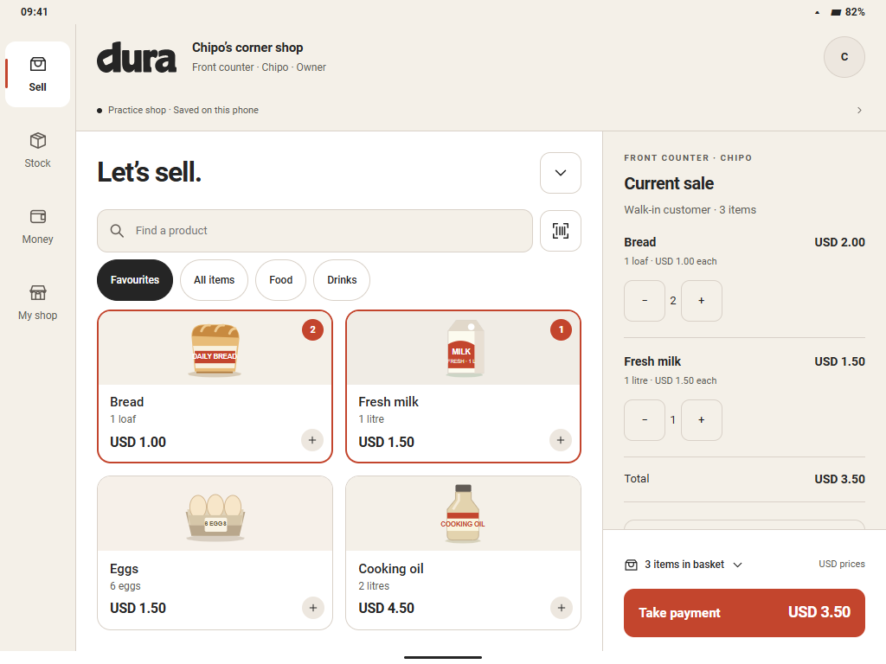

# Responsive feature-detail pass

10 November 2026. HTML design work only, inside `cdx`. No Flutter, backend,
native resource or dependency edits. [Task status](status.md) is the maintained
record of completed work and the next design slice.

## Try the layouts

Open [the review board](-cdx-preview.html), then choose **Device**:

| Preview | Browser viewport |
|---|---|
| Small phone | 320 × 740 CSS px |
| Phone | 390 × 844 CSS px |
| Tablet portrait | 768 × 1024 CSS px |
| Tablet landscape | 1024 × 768 CSS px |

The device frame changes the iframe's actual viewport; it does not stretch a
phone screenshot. The board scales the frame to fit your browser and states
the display scale. Switching devices preserves the basket and typed payment
input. The standalone prototype also adapts when its browser window is resized.
These are browser simulations; physical tablet hardware and keyboards remain
unverified. “Tab” was interpreted as tablet, rather than another bottom tab.

## Layout decisions

- Below 700 CSS px, retain the established bottom navigation and single-column
  workflow. Product selection and quantity editing work as before.
- At 700 px and above, use a navigation rail. Sell keeps an editable basket
  beside the shelf, with payment anchored beneath it. Four favourites use a
  balanced two-column shelf; larger catalogues can use more columns.
- Payment keeps the order summary beside cash entry. Normal-size tablet
  checkout shows change above the fixed Save action. Amounts keep their currency.
- Stock uses a list and selected-product preview. Selecting a row updates that
  preview without losing the list or filters. The detail action opens movement
  history; phone rows open the detail directly.
- Other forms have bounded reading widths. Accounts can place the statement
  beside cash entry. Extra space does not grant a seller more permissions.
- Enlarged text uses one content pane rather than squeezing an order panel
  beside a form. Forms and lists scroll independently of the main action.

[Portrait Sell](-cdx-tablet-sell-portrait.png) ·
[Tablet payment](-cdx-tablet-payment.png) ·
[Tablet Stock](-cdx-tablet-stock.png)

## Feature details added

| Area | Entry and primary action | More detail / recovery |
|---|---|---|
| Sell | Product shelf → Take payment | Persistent tablet basket, quantity editing, hold; same draft after resize |
| Stock | Search/filter → Receive stock | Low/out filters, empty recovery, selected preview, unit-labelled movement history |
| Product | Select a product → Receive / edit | Opening quantity and up to six recent movements with signed quantities and resulting balances |
| Receipts | Search/filter → Open receipt | Search ID, item or seller; cash/account/return filters; mobile filter where relevant; clear-search recovery |
| Customer | Balance → Review cash payment | Opening balance, account sales and payments; running balances; overpayment feedback |
| Supplier | Supplier → Statement / approved payment | Opening balance and payments; unknown due date stays unknown; deliveries remain separate |

Receipt lookup stays scoped to the current phone and role. Pending payments
remain outside completed receipts. Returns keep the original receipt and its
linked-return indication. Stock retains the existing sample threshold of four;
this is not a new production policy.

## Reconciled fictional examples

- Tariro starts owing **USD 14.50**. Collect **USD 5.00** cash: the statement
  records **− USD 5.00**, ends at **USD 9.50**, and the drawer gains USD 5.00.
  Sales do not increase.
- A **USD 3.50** account sale adds USD 3.50 to both sales and Tariro's debt;
  it does not put cash into the drawer.
- Mambo Wholesale starts at **USD 20.00** owed. An approved **USD 5.00** cash
  payment leaves **USD 15.00** owed and reduces the drawer by USD 5.00.
- Bread starts at **18 loaves**. Receive six: **+6**, resulting balance **24**.
  Sell two: **−2**, resulting balance **22**. A count correction records only
  the signed difference; it does not rewrite an earlier movement.

Older browser sandbox sessions without statement metadata start their opening
balance at the existing saved balance. New movements reconcile from there;
missing history is not invented. Account histories retain at most 30 movements
each and carry older movements into the opening balance. Stock history retains
at most 60 movements; the detail shows six and derives its opening quantity
before those six. New-shop setup resets these fictional histories.

These are optional additions to the existing browser-only practice state under
`dura-cdx-day-v2`. No production record/schema, migration or restore contract is
changed. No supplier purchase value is inferred from a quantity-only delivery.

## Checks and next slice

`node handbook/design/prototype/cdx/-cdx-check.cjs` includes the new responsive
workflow suite and phone/tablet render checks. It regenerates the phone boards
and tablet captures. Results are recorded in [status.md](status.md) after the
final run. It checks browser geometry, labelled controls and concrete workflows;
it does not prove device accessibility or vendor task times.

Next: supplier purchase invoices, including purchase cost, paid/due split and
evidence attachment, with a separate review before saving. Kept change,
fractional quantities, partial returns, deeper permissions and report periods
remain queued in status.md. The current pass does not silently decide those rules.
