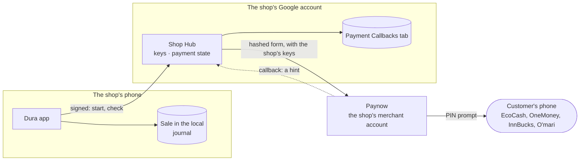
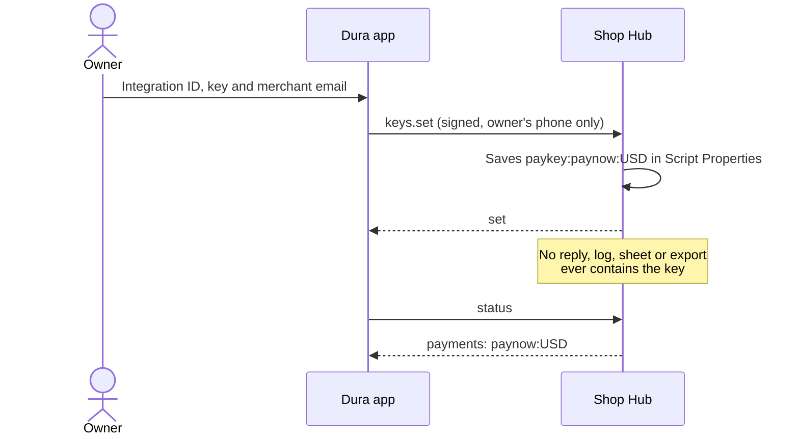
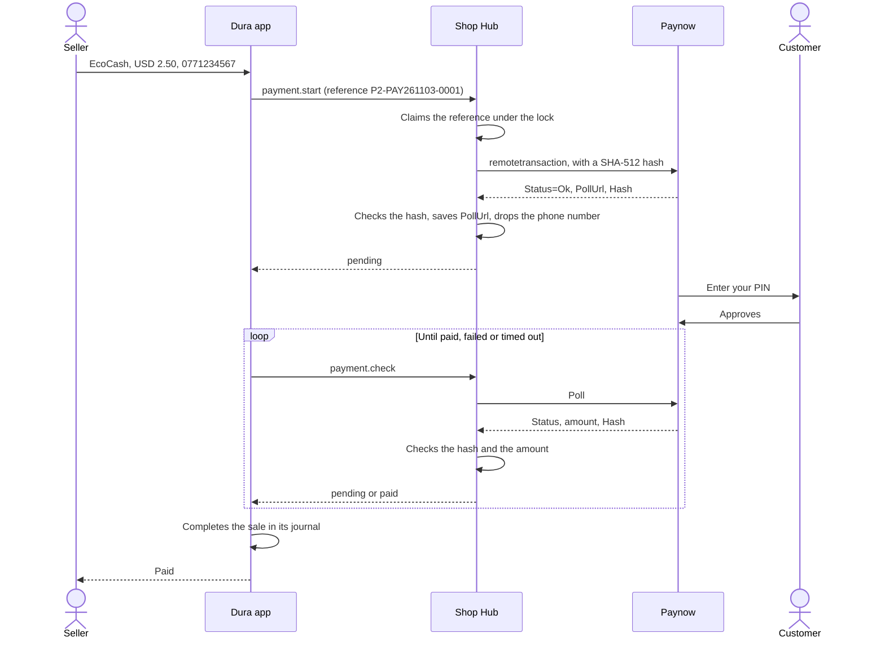
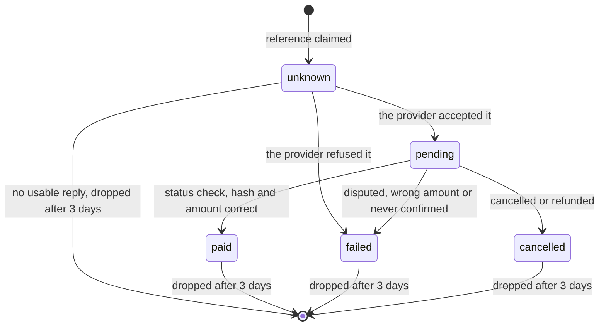
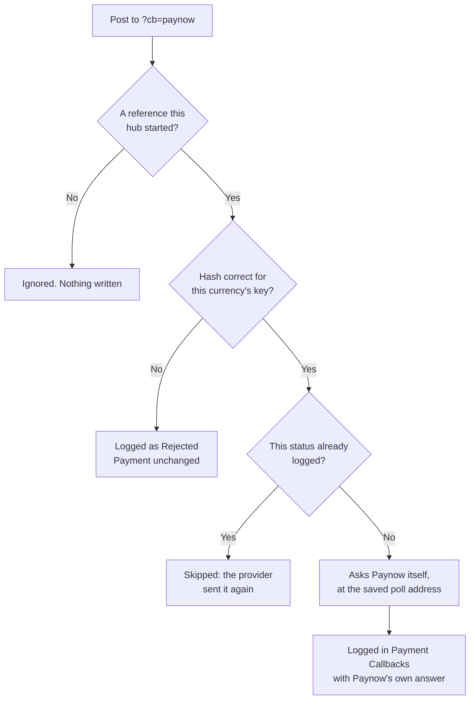
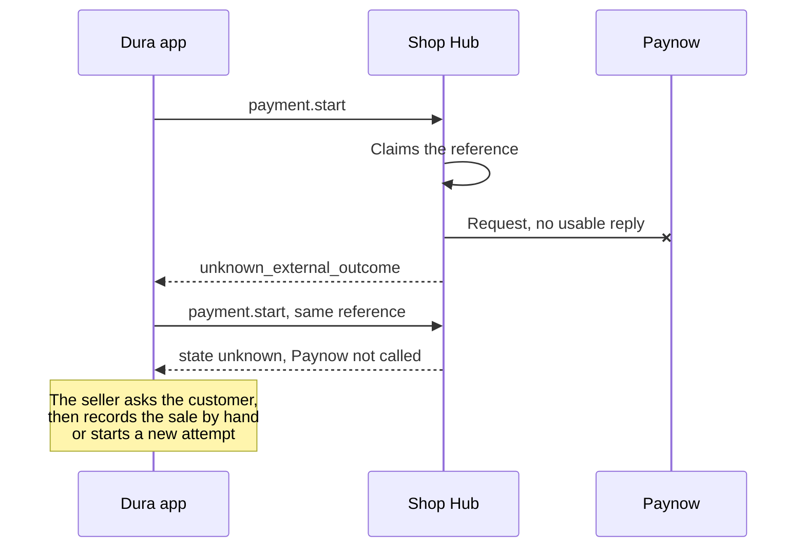

<!--
Copyright (c) 2026, DonnC & contributors.
Please see the AUTHORS file for details. All rights reserved.
Use of this source code is governed by the MIT license that can be
found in the LICENSE file at the repository root.
SPDX-License-Identifier: MIT
-->

# Payments

How a mobile-money payment moves through Dura. The code is in
[`backend/hub/src/payments.js`](../../backend/hub/src/payments.js) and
[`paynow.js`](../../backend/hub/src/paynow.js), and the wire format is in
[`PROTOCOL.md`](../../backend/hub/PROTOCOL.md).

**Status:** the hub's side is built, for Paynow's mobile checkout, and tested
against a fake Paynow. It hasn't been tried against Paynow's sandbox, and there
is no payment screen in the app yet.

## The rules

1. **Paid comes only from the provider's status check.** A callback can't mark a
   payment paid. It only makes the hub check sooner.
2. **A charge is never repeated.** A reference is claimed before the provider is
   called, so a retry finds the same payment.
3. **An unknown outcome stays unknown.** If the provider gave no usable reply, the
   customer may have been charged. The seller asks them; Dura doesn't guess.
4. **A payment never blocks a sale.** If it fails or can't be checked, the seller
   takes another method, or records a manual reference.
5. **The shop's keys stay in the shop's hub.** Phones never hold them. Money goes
   straight to the shop's merchant account; it never passes through Dura.

## Who does what

The hub moves the payment along. It doesn't record the sale: the phone does that
in its journal once it sees `paid`, and the sale reaches Sheets like any other.

## Setting up: once per currency

A Paynow integration belongs to one wallet, and Paynow's messages have no currency
field, so a shop that takes USD and ZWG sets two sets of keys.

## A payment that goes through

## States

A payment starts as `unknown` on purpose: if the hub stops between claiming the
reference and hearing back, the honest answer is that nobody knows.

| Paynow says | Dura reads |
|---|---|
| Paid, Awaiting Delivery, Delivered | `paid` |
| Created, Sent | `pending` |
| Cancelled, Refunded | `cancelled` |
| Disputed | `failed` |

A `paid` status with a different amount becomes `failed`, with a note. A poll reply
with a bad hash is ignored, and the payment stays `pending`.

## Callbacks are hints

Anyone on the internet can post to the hub's address, so nothing in a callback is
believed.

Every path answers plain `ok`. Google answers every web app POST with a redirect,
but the hub's code has already run by then. Whether Paynow is happy with that is
spike 5 in [note 15](../../notes/15-apps-script-route.md).

## When it goes wrong

| What happens | What the hub does | What the seller does |
|---|---|---|
| Paynow refuses the payment | `failed`, with Paynow's reason | Fixes the number or changes method. A new attempt is a new reference |
| No reply to `payment.start` | `unknown_external_outcome`; state `unknown` | Asks the customer whether they were charged. **Never charges again automatically** |
| The app retries `payment.start` | Returns the same payment; Paynow isn't called | Nothing |
| Same reference, different amount | `integrity_conflict` | Nothing: the app has a bug |
| Paynow is down during a check | `retryable_unavailable`; still `pending` | The app checks again, or takes another method |
| The phone goes offline after starting | The daily pass checks payments over an hour old | Checks the payment when back online |
| Nothing confirms it within 3 days | Closes it as `failed`, with a note | Reviews it with the customer |
| No keys for that currency | `payments_not_set_up` | Takes another method |

## Adding a provider

Each provider is one file behind `paymentAdapter_`, so the phone's protocol doesn't
change. ZB Smile&Pay is next.

| Part | Job |
|---|---|
| `methods` | The payment methods it offers |
| `keys(body)` | Checks and returns the keys to store |
| `start(record, keys, hubUrl)` | Starts a payment. Throws if the outcome is unknown |
| `check(record, keys)` | Returns `state`, `status` and `amount`. The only source of `paid` |
| `callback(raw, keys)`, `callbackReference(raw)` | Reads a status update, and says whether its signature is valid |

Wallets with no public API are written privately for one client and installed in
that client's own account, so that code isn't in this repository.

## Not built yet

- The app's payment screen, and its polling and timeout.
- Paynow's trace call, which could settle an `unknown` payment.
- InnBucks' authorisation code, which isn't passed back to the phone.
- Settlement matching: comparing gross, fees and payouts.
- Manual references, which are the app's job.
