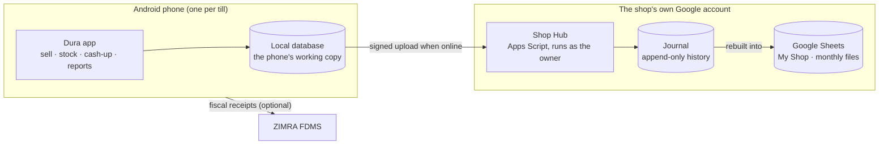

<!--
Copyright (c) 2026, DonnC & contributors.
Please see the AUTHORS file for details. All rights reserved.
Use of this source code is governed by the MIT license that can be
found in the LICENSE file at the repository root.
SPDX-License-Identifier: MIT
-->

# Dura POS: vision, users and the reasons behind it

2 November 2026. This is the product's north star. Read it first if you're
new: it explains what Dura is, who it serves, what it promises, and why it's
built the way it is. The engineering rules that follow from it are in
[`../engineering/`](../engineering/00-engineering-contract.md).

## The goal in one sentence

**Give every Zimbabwean vendor and small shop a point of sale that is free,
works offline, and keeps the shop's records in the shop's own Google account,
so the owner never has to pay, trust or ask anyone to keep trading.**

*Dura* is the Shona word for a granary: the store where a household keeps
what it has harvested. Dura POS is the shop's granary for its sales, stock and
money.

## The problem

- **Point-of-sale systems in Zimbabwe are rented.** Most off-the-shelf systems,
  including the ones bundled with Sunmi-style handhelds, charge a monthly or
  yearly fee and keep the shop's data on the vendor's servers.
- **Small traders don't want that.** They're cost-conscious and sceptical of
  subscriptions, and many keep records in an exercise book, a WhatsApp chat
  or a spreadsheet. If they stop paying, they lose the system and often the
  records with it.
- **Trading conditions are hard:**
  - a cheap Android phone;
  - patchy internet and expensive data;
  - power cuts;
  - three currencies (USD, ZWG, ZAR);
  - no change in the till;
  - informal credit;
  - expenses paid straight out of the day's takings.
- **Compliance is coming.** ZIMRA fiscalisation reaches more businesses each
  year, and is often what vendors charge the most for.

## Who it's for

| Person | Their day | What they need from Dura |
|---|---|---|
| **Street vendor or market trader** | Buys produce in the morning, sells all day, one phone, mostly cash | Fast cash sales, change worked out, "how much did I make today?" |
| **Tuck-shop owner** | Runs the shop with a relative, a few hundred products, some regulars on credit | Stock that adds up, kept change and money owed, a cash-up that balances |
| **Small shop with a few cashiers** | Two to ten phones, maybe two locations, an accountant at year end | Staff PINs and roles, cash-ups per shift, reports, fiscal receipts, mobile money |
| **The owner's accountant** | Sees the records monthly or yearly | Readable Sheets and Excel exports that reconcile, without learning Dura |

**Not for:** chains, franchises, warehouses, restaurants with table service, or
anyone needing enterprise administration. About ten phones is the upper end.
"Not an inflated idea."

## The promise

1. **Free, with no vendor cloud.** The app is free and open source. There is no
   Dura server holding shop data. The shop's own Google Drive (15 GB free with
   any Gmail account) is the only shared place.
2. **The records belong to the shop.** They live in the owner's Drive as Google
   Sheets the owner can open, read, edit, export and take elsewhere. Leaving
   Dura never needs our permission.
3. **Selling never waits for the network.** A sale is saved on the phone first
   and uploaded when the network allows. Nothing optional (sync, payments,
   fiscalisation, updates) can stop a cash sale.
4. **The shop's own keys.** ZIMRA credentials and payment-provider accounts are
   the business's own. Money goes straight to the business, not through Dura.
5. **Honest numbers.** Dura never adds currencies together, never invents a
   missing cost, and says so when a report is incomplete because a phone
   hasn't synced.
6. **Easy enough for anyone.** No screen should need more than five seconds of
   thought. See [the experience principles](03-experience-principles.md).

## How it works, briefly

- **The phone** does all the selling, from its own database.
- **The Shop Hub** is the shop's own backend: an Apps Script web app the app
  installs in the owner's Google account. Phones pair with it by QR code, and
  everything that reaches Google goes through it, so it counts against the
  shop's account. It also holds payment keys and runs scheduled work.
- **The journal** is an append-only record of every sale, payment and stock
  movement, stored in the owner's Drive by the hub. It is the shared history.
- **The Sheets** (`My Shop`, plus one file per month) are built from the
  journal for people to read, with Read Me tabs, dropdowns, colours and charts.
  The owner can edit the input tabs (products, prices, rates), and Dura checks
  those edits before accepting them.
- **ZIMRA fiscalisation** is optional, per business, and runs on the phone
  through [fzimra](https://github.com/DonnC/zimra-fdms-android). It's never
  routed through the hub.

The why behind each of these is in [decision 0003](../decisions/0003-records-journal-and-views.md),
[decision 0005](../decisions/0005-shop-hub-as-the-backend.md) and the
[architecture](../engineering/01-architecture.md).

## Why it's built this way

| Choice | Why |
|---|---|
| **The owner's Google Drive, not our server** | Hosting nothing means no running costs to pass on, no data liability, and nothing to switch off. Every business already has a Gmail account, and most have used a spreadsheet |
| **Google Sheets as the face of the records** | Owners and accountants already know them. A sheet can be opened on any device, shared with an accountant, and exported to Excel |
| **A journal behind the Sheets** | Sheets can't stop a retried upload from adding the same row twice, and a half-finished write can leave a tab wrong. The journal gives every event one ID, so views can be checked and rebuilt, and a damaged sheet never loses history |
| **Offline first** | Connectivity and power fail daily. A POS that stops when the network does loses sales |
| **Flutter, Android first** | One codebase for the phone now, with owner views on desktop or the web later. The ZIMRA SDK stays native Android, behind a typed bridge |
| **The shop's own Apps Script as the backend** | It runs as the owner, so its usage counts against the shop's account, not a shared Dura project. It holds payment keys and receives callbacks a phone can't. Phones never hold a Google sign-in. Sales still complete on the phone, so its cold starts and outages never stop selling |
| **A server-agnostic app** | The app talks to one backend port. If a shop or the project moves away from Google, only the adapter behind that port changes |
| **Bring your own keys** | The money and the regulatory relationship stay the business's own. Dura's developers never hold a shop's secrets |
| **Open source (MIT)** | Anyone can check that "we can't see your data" is true. Anyone can help a shop, fork it, or carry it on. See [decision 0002](../decisions/0002-client-layout-and-licence.md) |
| **Consulting, not subscriptions** | The app stays free. Shops that want setup, training, migration or a custom payment adapter can pay for that work |

## Business model

- **The core POS is free, forever,** with no mandatory subscription.
- **Revenue comes from consulting:** setup, training, migrating a business onto
  Dura, custom gateway adapters, and integrations.
- **A possible paid extra later:** "Ask Dura", an optional AI assistant
  ([note 14](../../notes/14-ai-assistant-plan.md)). The free route (export your
  files, use any AI with the [guide](../../notes/11-talk-to-your-data.md))
  always stays.
- **Never:** selling or mining shop data, or turning a free feature into a
  paid one.
- **Shops still pay their own running costs:** data, printers, provider fees
  and their own ZIMRA obligations. Dura doesn't pretend those disappear.

This is settled. Contributions shouldn't reopen it.

## Non-goals

- A Dura-run cloud, account system or data warehouse.
- Payroll with statutory deductions (PAYE, NSSA). Wages are recorded as an
  expense only.
- Filing tax returns. Dura produces the figures; the owner or accountant files.
- Claiming ZIMRA certification or approval that hasn't been granted.
- Public integrations with payment providers that haven't published an API.
  Those adapters are written per client and live in that client's Shop Hub.
- iOS, until there's a real need. Desktop and web start as owner views.

## Where it is now

**Foundation only. It doesn't sell yet.** The Flutter workspace, CI, local
preferences, shared UI components and on-device diagnostics exist. Selling,
sync, staff, payments and fiscalisation are designed but not built.
[The capability map](02-capabilities.md) shows each feature's status, and
[the roadmap](../engineering/06-roadmap.md) shows the order.

## What success looks like

- A real vendor sells for a full day on one phone, cashes up, and can read the
  day in their own Sheets.
- Five vendors complete the timed tasks (first sale within 5 minutes of
  installing, a 3-item cash sale in under 10 seconds, a cash-up in under 2
  minutes) without help.
- A shop can lose a phone, restore onto a new one, and lose nothing it had
  uploaded.
- A shop can leave Dura with a complete, documented export.

## Where this came from

The design was worked out over several research sessions in October and
November 2026. The reasoning is kept, not deleted:

- [`notes/`](../../notes/README.md): numbered design notes, the main record of
  decisions and their reasons;
- [`research/`](../../research/README.md): the original AI research
  conversations and briefs;
- [`../decisions/`](../decisions/): the decisions that changed earlier notes.
