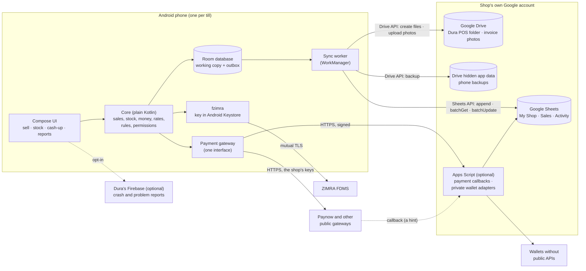
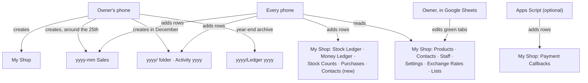
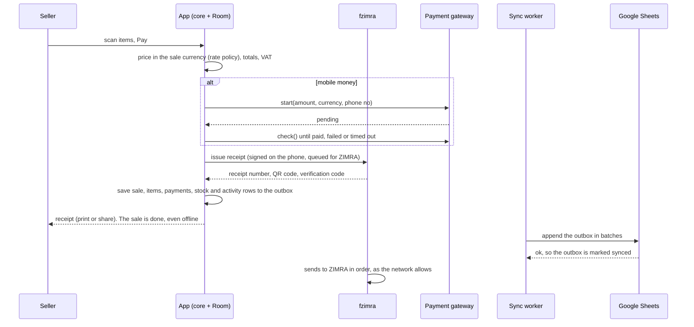

# Dura POS: the build plan

28 October 2026. **Start here.** This is the handover for building Dura POS:
what's decided, how it fits together, and the order to build it in. It's
written so someone on another machine (or a fresh AI session) can carry on
without the conversations that produced it. The details live in the other
notes; this one says which to read when.

## 1. What Dura POS is

A free, open-source Android point-of-sale for Zimbabwean street vendors and
small shops (1 phone, a few, at most about 10).

- **Sells offline**, in USD, ZWG and ZAR.
- **Fiscalises with ZIMRA** on the phone, through the fzimra SDK.
- **Takes mobile money** through the business's own payment accounts.
- **Keeps every record in the owner's own Google Drive**, as Google Sheets the
  owner can open, read and edit.

**Settled decisions (don't reopen them):**

| Decision | Detail | Where |
|---|---|---|
| No vendor cloud | There's no Dura server for shop data. The owner's Google Drive/Sheets is the only shared place | `03` |
| Bring your own keys | The business's own ZIMRA credentials and payment-provider keys | `03` |
| Revenue | Consulting, for businesses that want setup or custom work. The app is free | `03` |
| Scale | Street vendors and small shops, not chains. "Not an inflated idea" | `03` |
| Sign-in | The owner's (preferably shop-only) Google account on every phone. Sellers only use the app, with a PIN, unless the owner raises their access | `03`, `05` |
| One file set per business | `My Shop` (permanent) + a folder per year holding `Activity <year>` and a monthly `<yyyy-mm> Sales` file. Formulas never cross files | `04` |
| Phones add rows | Rows are never rewritten, except status cells on a phone's own rows (and the owner's phone updating payment status). Rows are removed only by the verified year-end archive | `04`, `05` |
| Only the owner's phone creates files | Next month's file around the 25th; next year's folder in December | `05` |
| Prices | One price per product in the pricing currency (USD). Other currencies come from the exchange rate | `04`, section 6 here |
| Sheets a person can use | Read Me in every file, colour-coded tabs, dropdowns instead of typing, date pickers, red negatives, status dots, charts | `04` |
| Fiscalisation | Each selling phone is its own ZIMRA device, under its location's ZIMRA branch | `09` |
| Payments | One gateway interface in the app; public providers built in; private wallets through the business's own Apps Script | Section 5 here |

**Rules for whoever builds it:**

- Never add AI attribution (Co-Authored-By trailers or similar) to commits,
  PRs or files.
- Notes go in `notes/`, numbered.
- **Work in phases:**
  - agree the scope;
  - build it with tests;
  - update the changelog;
  - commit;
  - then start the next phase.
- **Reuse before building:**
  - fzimra (`~/Documents/projects/zimra-fdms-android`, GitHub
    `DonnC/zimra-fdms-android`) for ZIMRA;
  - the TypeScript `zimra-fdms` SDK and `zw_compliance` (ERPNext) as
    references.
- **Read ZIMRA's spec strictly.** Offer only what it allows, and never an
  option that can stop a shop from trading.
- **Public posts** about this work:
  - no code blocks;
  - don't claim ZIMRA certification you don't have;
  - credit Shaun Chivandire for the original TypeScript SDK.

## 2. The notes, and when to read them

| Note | Read it when |
|---|---|
| `01-assessment.md` | You want the honest market and risk picture. Sections 1 and 7 are superseded by `03` |
| `02-questions-for-zimra.md` | Before fiscalisation, kept change, invoices or branches. Send these to ZIMRA early; file the answers there |
| `03-feature-design.md` | The feature list and sync design. File and tab details are superseded by `04` |
| `04-data-files.md` | **The data model:** every file, tab, column, ID, ledger type, the currency rules, dropdowns and colours, and file-size limits |
| `05-archiving-and-security.md` | Archiving and year end, what a phone keeps, who can reach the data, PINs, keys, checklists |
| `06-apps-script-gateway-assessment.md` | Before deciding how much Apps Script to use |
| `07-customers-sync-onboarding-updates.md` | Syncing big lists, five-minute onboarding, updating a shop's sheets and script without losing data |
| `08-change-invoices-suppliers-ux-support.md` | Kept change, invoices and quotes, suppliers, the five-second rule, problem reports, Firebase |
| `09-locations-phones-staff.md` | Shops, branches and stores; phones against staff; roles; reporting |
| `10-build-plan.md` | This note |
| `11-talk-to-your-data.md` | The guide for owners who want an AI to read their files (it also ships with the app) |

**The executable spec** is `samples/generate_samples.py`. It builds a complete,
realistic sample shop (`samples/Dura POS/`): every file, tab, column,
dropdown, colour rule, formula and chart the app must create. Two scripts read
the sample back and prove it adds up:

- `samples/check_samples.py`;
- `samples/check_formulas.py`.

When the app's sheet layout changes, change the generator first, regenerate,
run both checks, then build the app to match. `reference/zimra_hs_codes.csv`
is ZIMRA's HS code list.

```
cd samples
python3 generate_samples.py          # needs openpyxl
python3 check_samples.py "Dura POS"
python3 check_formulas.py "Dura POS"
```

## 3. Architecture

### 3.1 The pieces



| Piece | Job | Notes |
|---|---|---|
| **Room database** | The phone's working copy, and the source of truth for everything the phone does while offline | Master data (products, contacts, staff, settings, rates), its own location's stock, open items, 7 days of synced sales, and the **outbox** of unsynced rows |
| **Outbox** | Every new row (sale, payment, ledger, activity) waits here until a sync confirms it | Rows carry their ID, so retrying never duplicates |
| **Sync worker** | Pushes the outbox, pulls master data | WorkManager: every 15 minutes in the background, shortly after a sale, on *Sync now*, and at day end. Batched `values.append`; pulls in one `values.batchGet` |
| **Sheets API** | Reads and writes rows; creates tabs, formulas, dropdowns, colours and charts | `batchUpdate` for layout. Columns are found by heading, never by position |
| **Drive API** | Creates the folder and files; uploads invoice photos; holds backups in hidden app data | Scope `drive.file`, which reaches only the files Dura created. Backups need `drive.appdata` too (still to check, section 10) |
| **fzimra** | Everything ZIMRA: registration, signing, receipts, fiscal days, retries | Its key never leaves the phone. Talks to ZIMRA directly over mutual TLS. Apps Script can never do this |
| **Payment gateway** | One way to take a non-cash payment, whatever the provider | Section 5 |
| **Apps Script** (optional) | Runs in the shop's own Google account: receives payment callbacks, and hosts adapters for wallets without public APIs | Never holds business logic or ZIMRA. Thin, versioned, updated in place (`07`) |
| **Firebase** (optional) | Dura's own: crash reports, problem reports, update notices, remote switches | No business data, ever. Free tier only. There's also a build without it (`08`) |

### 3.2 Who touches which file



### 3.3 A sale, end to end



### 3.4 Sync

- **Push:** outbox rows are grouped by file and tab, and sent with one
  `values.append` per tab. The phone reads back the row IDs it sent (cheaply,
  by range) before marking them synced. A failed or doubtful batch is resent;
  IDs make that safe.
- **Pull:** Products, Contacts, Staff, Settings, Exchange Rates and Lists come
  in one `values.batchGet`:
  - at app start and in the morning;
  - on *Sync now*;
  - after an owner's change in the app;
  - every hour.

  The owner's sheet edits are checked first. Bad rows are skipped and listed
  in Activity.
- **Status cells** (fiscal status, payment status) are found by row ID and
  updated with `values.batchUpdate`.
- **Files by ID.** The phone keeps the file IDs it has been given. It never
  searches Drive by name.

### 3.5 A phone's data

What a phone keeps, and for how long, is set out in `05` ("What a phone
keeps"). In short:

- master data and its location's stock, always;
- unsynced and open items, until they're done;
- synced sales, for 7 days.

Anything older is read from the sheets when it's needed.

### 3.6 Suggested code layout

| Module | Contents |
|---|---|
| `:core` | Plain Kotlin, no Android: sale maths in `BigDecimal`, currencies and the rate policy, stock and money rules, permissions, IDs |
| `:store-local` | Room entities, DAOs, the outbox |
| `:store-sheets` | **The sheet schema as code:** each file, tab, column, kind, dropdown, format and colour rule, in one definition. It also holds file creation, row mapping by heading, migrations, and the year-end archive |
| `:sync` | WorkManager jobs; push and pull |
| `:payments` | The `PaymentGateway` interface, the registry, and providers: Paynow, the shop-script provider, manual |
| `:fiscal` | An adapter onto fzimra's `FiscalTerminal` |
| `:app` | Compose UI, onboarding, reports, Google sign-in |
| Flavours | `play` (with Firebase, ML Kit barcode scanning) and `foss` (no Google services beyond sign-in; ZXing for scanning) |

The schema module and `generate_samples.py` describe the same layout. When
the layout changes, change both, and bump the layout version (`07`).

**Libraries to start from:**

- Kotlin, Jetpack Compose, Room and WorkManager.
- Credential Manager and Google's `AuthorizationClient` for sign-in and Drive
  scopes.
- The Sheets and Drive REST APIs through OkHttp and kotlinx.serialization:
  lighter than the full Google API client.
- CameraX with ML Kit or ZXing for barcodes.
- ESC/POS over Bluetooth for the cheap thermal printers common in Zimbabwe.
- fzimra.

## 4. The sheets, and the year

The full model is in `04`. These are the decisions that matter when coding.

- **Live tab names never contain a year.**
  - The live tabs in `My Shop` are `Stock Ledger`, `Money Ledger`, `Stock
    Counts`, `Purchases` and `Payment Callbacks`.
  - The year they hold is `Settings` → `Data year`.
  - Formulas read that cell (the Summary does, through `INDEX/MATCH` on
    Settings) and filter by date.
  - So no formula names a year, and nothing breaks on 1 January.
  - Only *archive* names and *file* names carry a year: `2025/Ledger 2025`,
    `Stock Ledger 2025`, `2026-10 Sales`, `Activity 2026`. Formulas never
    cross files, so those names are never inside a formula.
- **The year end is automatic** and runs on the owner's phone (`05`, "Every
  year"):
  1. copy last year's rows to the archive file;
  2. verify the copy;
  3. add closing stock and balances;
  4. in one update, remove last year's rows from the live tabs and add
     `Opening` rows;
  5. move `Data year` on.

  Each step is resumable, and late rows are handled.
- **Names are kept stable,** and the app finds tabs and files by ID, never by
  name.
  - If an owner renames a tab, Google Sheets updates the formulas that point
    to it, and Dura still finds the tab by its ID.
  - Dura's own tabs are rebuilt by updates (`07`), so a broken formula there
    heals on the next update.
- **Month and year files** are created from code, with the newest layout.
- **Size watch:** past 70% of Google's 10-million-cell limit, the owner's
  phone splits the file (`04`, "How big can the files get?").

## 5. Payments: one entry point for every gateway

**The idea:** the app has one way to take a non-cash payment. Each provider is
a plug-in behind it. A business switches on only the providers it uses.
Nothing changes for a business that doesn't use one.

```kotlin
// The single entry point. Every provider implements it.
interface PaymentGateway {
    val id: String                       // "paynow", "shop-script:onemoney", "manual"
    val methods: Set<PaymentMethod>      // EcoCash USD, InnBucks USD, card, ...
    suspend fun start(request: PaymentRequest): PaymentStart   // pending, with instructions or a reference
    suspend fun check(reference: String): PaymentStatus         // Paid, Pending, Failed, Cancelled
    suspend fun cancel(reference: String): Boolean = false
}
```

The app asks the registry which provider handles a payment method, using
`Payment Methods` → `Provider`. It calls `start`, then polls `check` until the
payment is paid, fails or times out. A payment is **only ever marked paid by a
`check`**, never by an incoming message.

### Three kinds of provider

| Kind | For | Where the code lives | Keys |
|---|---|---|---|
| **1. Built in** | Providers with public, documented APIs: **Paynow** first (EcoCash, InnBucks and cards through Paynow), then other public aggregators once their documentation and terms are checked | The open-source app (`:payments`) | Entered on each phone, kept in Android Keystore (`05`). The business's own merchant account |
| **2. Shop script** | Wallets and providers **without public APIs**, where the business has its own merchant arrangement. Set up through consulting | **The business's own Apps Script**, in their Google account. Dura's app has one generic "shop script" provider that talks to it | In the script's private properties, in the business's account. Dura's developers never hold them |
| **3. Manual** | Anything else: bank transfers, a wallet with no integration | The app: the seller enters the reference from the customer's SMS. Above a set amount, it needs the owner's PIN | None |

**Why the shop script keeps everyone safe:**

- **The code isn't public.** The public repo contains no integration with a
  provider that hasn't published an API. Each private-wallet adapter is
  written for one client, against the access *that business* has been given
  (their merchant API, their credentials). It's installed in *their*
  account.
- **The money and the keys are theirs.** Money moves straight to the business
  under their own agreement with the provider, and the keys stay in their
  account.
- **One snippet per wallet.** Once installed, the business is settled. The
  app needs no update to support a new wallet, because the script speaks the
  same contract.

### The shop script contract (version 1)

The script is the same thin web app described in `06` and `07`, deployed from
the business's account. Apps Script can't read request headers, so the
signature travels in the body.

```
POST <the shop's script URL>
{ "v": 1, "action": "start", "method": "OneMoney USD", "ref": "P4-S261028-0031",
  "amount": "3.50", "currency": "USD", "payer": "+26371...",
  "phone": "P4", "ts": 1793180000, "sig": "<HMAC-SHA256 of everything else, with the phone's pairing secret>" }
-> { "v": 1, "status": "pending", "providerRef": "...", "message": "Customer to approve on their phone" }

{ "v": 1, "action": "check", "ref": "...", ... }
-> { "v": 1, "status": "paid" | "pending" | "failed" | "cancelled", "amount": "3.50", "currency": "USD", "providerRef": "..." }
```

**The script must:**

- check the signature and the timestamp;
- refuse any phone not paired with the shop;
- keep secrets in Script Properties;
- record each reference once;
- answer within the provider's time limits.

The app follows Apps Script's redirect on POST. The template script (with no
provider code) lives in the public repo. The adapters don't.

**Callbacks** from public gateways can be received by the same script. They
are only hints, and the till confirms with `check`. Every callback is written
to `Payment Callbacks`, and a rejected one is shown in red.

## 6. Exchange rates: the policy

The owner chooses one policy in Settings. The app enforces it, and every
payment row records the `Rate used`.

| Setting | Options | Default |
|---|---|---|
| **Rate policy** | **Daily rate:** one rate per currency for the whole day, set in the morning. Changing it mid-day applies from tomorrow, unless the owner overrides with their PIN.<br>**Latest rate:** the owner (or a manager) can change the rate at any time, and each sale uses the newest rate the phone has | Daily rate |
| **When today's rate is missing** (daily policy) | **Ask:** the first sale in that currency asks for today's rate (owner or manager PIN).<br>**Use the last rate with a warning:** it's printed on the screen, and recorded in Activity.<br>**Block:** no sales in that currency until today's rate is set; USD sales carry on | Ask |
| **Who may set rates** | Owner only, or owner and managers | Owner only |
| **Rounding** | Per currency, e.g. ZWG and ZAR to 0.50 | ZWG 0.50, ZAR 0.50 |
| **Rate source** | Manual, typed or picked from yesterday's. A reference rate (e.g. the official rate) may be *shown* beside it later, but the shop's own rate is what's used | Manual |

**How it works:**

- **The Exchange Rates tab** gets a `Time` column and an `Applies` column (`Day`
  or `From this time`). The daily policy writes one row a day; the latest
  policy writes one row per change.
- **Phones get rate changes on their next pull.** An offline phone uses the
  last rate it has, shows a "rate from <time>" banner, and records that rate.
- **A sale keeps its rate.** A cart priced before a change keeps its prices
  until it's paid or cleared. That way the customer is never surprised at the
  till.
- **The "block" option only ever blocks foreign-currency sales.** USD (the
  pricing currency) always works, so a missing rate can never stop a shop
  from trading.

The sample uses the daily policy. Add `Time` and `Applies` to the generator
when this is built.

## 7. Build phases

Each phase ends with:

- tests;
- a changelog entry;
- a commit;
- a check against `samples/` (the app's output should match the generator's
  layout).

| Phase | Scope | Done when |
|---|---|---|
| **0. Validate and prototype** (in parallel) | Send `02` to ZIMRA. Talk to 5 shops. Spikes: (a) two phones with the same Google account see the same `drive.file` files; (b) Sheets append and batchGet timing at 10,000 rows; (c) Paynow sandbox `start`/`check`; (d) fzimra in a bare app against its simulator; (e) one Apps Script template deployed from a fresh account (time it, and screenshot the "unverified" screen) | Each spike answered in `notes/`; go or no-go on `drive.file` sharing and on the Apps Script gateway (`06`) |
| **1. One phone sells** | Onboarding (5 minutes), products (scan, import), cash sales in USD, ZWG and ZAR with the rate policy, receipts (share and Bluetooth print), the local database and outbox, `My Shop` and month files created from code with Read Me, Lists, dropdowns and colours, the Stock Ledger, cash-up, Activity | A real vendor sells for a day; the sheets match the sample's layout |
| **2. Several phones and people** | QR pairing, PINs, roles (owner, manager, seller), locations and moves, stock takes, Settings and Staff from the sheet, the owner's phone creating files, the 7-day phone clean-up | Two phones and two sellers for a week, with no duplicates and cash-ups that balance |
| **3. Fiscalisation** | fzimra: registration, receipts, fiscal days, credit notes, branch per location, the Fiscal Days tab, guided ZIMRA test, samples and approval | A full ZIMRA test-environment day, closed cleanly. Follows ZIMRA's answers to `02` |
| **4. Payments** | The `PaymentGateway` interface; Paynow (EcoCash, InnBucks, card); the manual provider; the shop-script provider, the template script and pairing; Payment Callbacks | A Paynow sandbox payment is confirmed by polling; a template-script provider works end to end |
| **5. Customers and money owed** | Contacts, kept change, invoices on account, quotes, suppliers and purchases (with photos), Balances, the Money Ledger, order lists to share | The sample's scenarios can be done in the app in under 5 seconds of thought per screen |
| **6. Reports and running the shop** | Home cards and reports by role, the day-end message, year-end archive, file-size watch, sheet updates and migrations (`07`), backups and restore | The sample's year end runs on test data; a migration adds a column without losing a row |
| **7. Support and release** | Problem reports with references and public GitHub issues, optional Firebase, the `foss` build, Play Store listing and data-safety form, `11` shipped in the app, the five-vendor usability test | Five vendors pass the timed tasks in `08`; beta on Play |

## 8. Onboarding, ease of use, support

These are designed in `07` and `08`; this is the checklist.

- **Onboarding:**
  - selling within 5 minutes;
  - one ordinary Google sign-in;
  - everything optional sits on a "Set up when you need it" checklist.
- **The five-second rule:**
  - no screen should need more than five seconds of thought;
  - one main action per screen;
  - defaults everywhere;
  - undo instead of "Are you sure?";
  - never block a sale;
  - plain words in English, Shona and Ndebele.
- **Problem reports:**
  - a reference number, and a link to WhatsApp;
  - tracked as public GitHub issues, with business data removed;
  - the app tells the person when their issue is fixed.

## 9. The AI guide

`11-talk-to-your-data.md` explains, for owners, how to let an AI (Claude,
Gemini, NotebookLM, ChatGPT) read their files. The app writes a copy into
each shop's `Dura POS` folder, as `About my Dura files (for AI)`. It's
updated whenever the layout version changes, so the description always
matches the files.

## 10. Open questions

| Question | How to settle it |
|---|---|
| ZIMRA: approval per business or per software, non-VAT traders, kept change money type, invoice on account, branches and devices (all in `02`) | Ask ZIMRA; file the answers in `02` |
| Does a second phone, signed in with the same account, see the files under `drive.file`? | Spike 0(a) |
| Is `drive.appdata` (for phone backups) a non-sensitive scope that needs no Google verification? | Check Google's scope list. If it's a problem, back up into a hidden `Backups` folder created under `drive.file` |
| Apps Script gateway for all syncing, or just payments? | Spike 0(e); `06` |
| Which public payment aggregators besides Paynow? | Read each one's public docs and terms before adding it |
| A Stock Card tab (pick a product, see its movements) | It works in Google Sheets with `FILTER`; add it in phase 6 |

## 11. Moving to another machine

- Everything needed is in this repository:
  - the notes;
  - the generator and the checks;
  - the HS code list;
  - `CLAUDE.md`, the standing rules for an AI assistant.
- Commit and push before switching. On the new machine, clone the repo and
  install `openpyxl`, then run the three commands in section 2.
- The source for the sibling projects:
  - fzimra: `github.com/DonnC/zimra-fdms-android`;
  - zw_compliance, the ERPNext app (it's where the HS code list came from).
