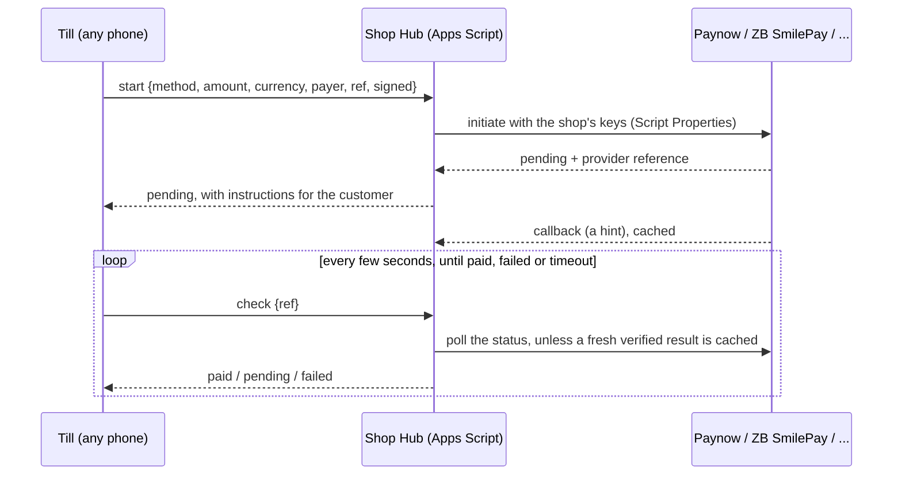

# The Shop Hub, test mode, file layout, and moving a business onto Dura

28 October 2026. This settles questions raised after `10`, and **it wins over
earlier notes where they differ.** `10` and `04` have been updated to match.
The sample generator still has the older layout (see `10`, "Spec changes
waiting in the generator").

## 1. How the app talks to Google: API, SDK or Apps Script?

**"Direct API" and "SDK" are the same thing.** Google's Android/Java client
libraries are wrappers around the same Sheets and Drive REST APIs.

- **Use the REST APIs directly**, with OkHttp and kotlinx.serialization. That
  avoids the full Google API client's size.
- The **sign-in and permission** part does use Google's Android libraries:
  Credential Manager and `AuthorizationClient`.

**The phone's data path is direct to Sheets.** Every phone reads and writes
the shop's sheets through the Sheets API, as in `10` section 3. It's:

- fast: batched appends of hundreds of rows in one request;
- simple: no script needs to exist for a shop to work;
- unaffected by Apps Script's limits (30 runs at once, cold starts, redirects
  on POST).

**Apps Script becomes the Shop Hub,** for the jobs it's genuinely better at:

- jobs that must run when no phone is on;
- secrets that one business shares across phones.

It never sits in the path of a sale.

## 2. The Shop Hub (Apps Script, in the shop's own account)

### What it does

| Job | Why the hub | Without the hub |
|---|---|---|
| **Payment gateways:** start, check and receive callbacks for Paynow, ZB SmilePay and the rest | One business means one merchant account. Its keys belong in one place, not on 3 phones. A lost phone holds no payment keys. Callbacks need a public URL anyway | No mobile-money integration. Cash, card on its own machine, and manual references only |
| **Scheduled file work:** next month's file (around the 25th), next year's folder (December), the year-end archive, the file-size watch | Runs on a timer whatever the phones are doing: off, offline, stolen, or out of data | The owner's phone does it when it's next online (`05`) |
| **Daily and weekly jobs:** the day-end summary to the owner, kept change reminders, overdue invoices, low stock across locations | No phone has to be on at closing time | The owner's phone builds the summary at its own cash-up |
| **Checking:** at night, a sweep for gaps (a phone that hasn't synced, a fiscal day left open, a cash-up missing) | Someone should notice when a phone goes quiet | The owner notices on the home screen |

The hub **never**:

- holds ZIMRA keys or talks to ZIMRA. Each device's key stays on its phone,
  and Apps Script can't do mutual TLS (`06`);
- sits in the path of a cash sale.

**When it's installed:** it's optional, and installed when a shop switches on:

- mobile-money payments; or
- a second phone; or
- "automatic month and year files".

A single-phone vendor taking cash never needs it.

### Installing and updating it

Spike 0(e) in `10` must time this before it's final.

1. **Turn on the Apps Script API, once.** In onboarding, the app opens Google's
   Apps Script settings page, and the owner turns on the switch "Google Apps
   Script API". This is the one unavoidable manual step.
2. **The app installs the hub.**
   - It creates the script project with the Apps Script API, bound to
     `My Shop`.
   - It uploads the hub code, creates a version, and deploys it as a web app
     (run as the owner).
   - It then guides the owner to open the script once and approve it. Google
     may show "Google hasn't verified this app" for the owner's own script.
     The guide shows exactly what to tap.
3. **Updates** happen in place, from the owner's phone:
   - new code;
   - a new version;
   - the **same** deployment, so the web address never changes (`07`).

   Hub messages carry a protocol version, and the app supports older hubs for
   a long time.
4. **Pairing.** Each phone gets its own secret from the owner's phone, by QR
   code, and signs every hub request with it.
5. **Cost to Dura:** the Apps Script scopes need Google's app verification.
   It's free, but needs a homepage, a privacy policy, and time. Apply early.

The hub code is open source. **Adapters for providers without public APIs**
are written per client (through consulting) and added to that client's hub.
They're never in the public repo (`10` section 5).

### Payments through the hub

The single entry point from `10` section 5 stays. The app's `PaymentGateway`
now has one main implementation, **"hub"**, which forwards `start`, `check`
and `cancel` to the shop's hub. Inside the hub, each provider is an adapter
behind the same contract.



- **First providers: Paynow and ZB SmilePay.**
  - Paynow publishes its integration documentation.
  - For SmilePay, check what ZB publishes and what its merchant onboarding
    gives a business. If it's a public, documented API, its adapter ships in
    the open hub. If it's only given to each merchant, it's a per-client
    adapter.
- **Sandbox and live keys** sit side by side in the hub. The request's mode
  picks which (section 4).
- **Manual references** (the seller types the SMS reference) stay in the app.
  They work with or without the hub.

## 3. "Syncing to Drive"

**Writing to Google Sheets is writing to Drive.** The sheets *are* Drive files.
There's no second upload step for the data.

- **What "sync" means.** A phone works from its own database, so a sale is
  saved instantly, even offline. "Sync" is the moment the phone's waiting rows
  (its outbox) are written into the sheets. It happens:
  - a few seconds after a sale, if online;
  - every 15 minutes in the background;
  - on *Sync now*;
  - at cash-up.
- **The other way:** the phone also pulls the owner's changes (prices,
  products, rates).
- **The only true file uploads** are:
  - product photos and supplier invoice photos (section 6);
  - each phone's daily backup.

## 4. Test mode

**Test mode is a separate shop.** Nothing in test mode can touch live data,
live ZIMRA or live money.

| | Live | Test |
|---|---|---|
| **Files** | `Dura POS/<business>/` | `Dura POS/<business> (TEST)/`, with its own `My Shop`, months and everything else. It's created the first time test mode is used, and starts as a copy of the live products, contacts, staff and settings (the owner can refresh it) |
| **Phone database** | The live database | A **separate** database file. Switching mode switches databases |
| **ZIMRA** | Live device, live environment | ZIMRA's **test environment**, with the phone's test device and certificate. These are separate registrations, as ZIMRA's process requires |
| **Payments** | Live keys | The provider's **sandbox**, with sandbox keys in the hub |
| **IDs** | `P4-S261028-0031` | `T-P4-S261028-0031`, so a test row can never be mistaken for a live one, even if copied |
| **Receipts** | Normal | Printed **"TEST: NOT A VALID RECEIPT"** |
| **Screen** | Normal | An orange striped **TEST MODE** bar on every screen |
| **Reports, stock, balances** | Live only | Test only |

**Practice mode** is a lighter version of test mode, for training sellers. It
works like test mode, but needs no keys or ZIMRA test device:

- ZIMRA is played by fzimra's built-in simulator;
- payments by a fake provider that always succeeds after a few seconds.

**Switching and clearing:**

- Changing mode needs the owner's PIN, and is recorded in Activity in both
  shops.
- Test data can be kept or deleted (the whole `(TEST)` folder) at any time.
- Live data is never touched by test mode.

**When a shop goes live with ZIMRA,** the guided steps run in test mode first:

1. register the test device;
2. run a test fiscal day;
3. send sample documents.

Then live registration happens on the live side.

## 5. How files are created

**From code, not from a template file.**

- **The layout lives in one place.** The sheet layout is defined once, as a
  machine-readable schema: files, tabs, columns, kinds, dropdowns, formats,
  colour rules, formulas and charts. Planned as `schema/dura-sheets.json` in
  this repo.
- **Three things are built from that schema:**
  - the app, through the Sheets API (`spreadsheets.create`, then one
    `batchUpdate` for tabs, validation, conditional formats and charts);
  - the hub, through `SpreadsheetApp`;
  - the sample generator, in Python.
- **Why not a template file:**
  - `drive.file` can only reach files Dura created;
  - code-built files always have the current layout version;
  - the same schema drives migrations (`07`).
- **Who creates files and when:**
  - `My Shop` is created in onboarding, by the owner's phone.
  - Month and year files are created by the hub on its timer. Without a hub,
    the owner's phone creates them.
  - **A `Files` tab** in `My Shop` (Dura's, grey) lists every file's ID,
    month or year, and layout version. Phones and the hub look files up
    there, never by name.
  - **If a phone needs a month that doesn't exist yet** (no hub, owner
    offline), it keeps the rows. It never creates the file itself.

## 6. Folders, files and photos

### The folder layout

```
Google Drive (the shop's Google account)
└── Dura POS/
    ├── Chipo's Corner Shop/              one folder per business (TIN)
    │   ├── My Shop                       permanent: products, stock, contacts, settings, ledgers…
    │   ├── Product photos/               P001.jpg, … (one per product)
    │   ├── 2026/
    │   │   ├── 2026-10 October           one file per month: sales, payments, cash-ups,
    │   │   │                             fiscal days, quotes, ACTIVITY, summary
    │   │   ├── …
    │   │   └── Supplier invoices/        photos of supplier invoices, by Purchase ID
    │   └── 2025/
    │       ├── Ledger 2025               the closed year
    │       └── 2025-12 December
    └── Chipo's Corner Shop (TEST)/       test mode: the same layout, separate data
```

**Why not shop > branch > year > month?** A branch is a column, not a folder.

- **Totals need one file.** The owner wants the whole business at a glance,
  and formulas can't cross files.
- **Moves need one ledger.** Moving stock between branches is two rows in one
  ledger. In two files, the two halves could drift apart.
- **Branches can still be seen apart.** Each month's Summary already splits by
  location, and every tab can be filtered by `Location`. Dura can also add a
  saved filter view per branch, so a manager opens "Mbare" in one tap.
- **The case for a split:** if a branch manager must see *only* their branch
  in the sheets, the hub can write a separate read-only copy for that branch
  each night. Build it only when a client asks.
- **A different business is different:** another TIN gets its own folder at
  the top (`Dura POS/<business>/`). One Google account can hold several.

**Why not a folder per month?** A month is one file, so a folder holding one
file adds a click and nothing else. The year folder holds the twelve month
files, plus the year's supplier invoice photos.

### Activity moves into the month file

- **Activity is now a tab in each month's file,** not a yearly file. "What
  happened in October" is then one file: sales, money, cash-ups, fiscal days
  and the audit trail together.
- **The monthly file is renamed** `2026-10 October`, not `2026-10 Sales`,
  since it now holds more than sales. The number keeps the files in order;
  the month name makes them easy to read.

### Photos

| Photo | Goes to | Notes |
|---|---|---|
| **Product photo** (taken or picked in the app) | `<business>/Product photos/<Product ID>.jpg` | Shrunk on the phone to about 800 px, under about 150 KB. A new photo replaces the old one. `Products` → `Photo` holds a link. Phones keep small thumbnails as master data; the full photos stay in Drive |
| **Supplier invoice photo** | `<business>/<year>/Supplier invoices/<Purchase ID>.jpg` | `Purchases` → `Invoice photo` holds a link |
| **Receipt or quote PDFs** | Not kept by default; made on the phone when shared. Optional: `<business>/<year>/Shared documents/` | |

All photos are files Dura created, so `drive.file` covers them. They're
private to the shop's account.

## 7. The pricing currency is the shop's choice

**Dura doesn't assume USD.** In onboarding, the owner picks:

- the **pricing currency**: the one currency every product's price is set in
  (USD, ZWG, or another). There's no default; it's a required choice, with
  the common options first;
- the other currencies they accept, with their rates against the pricing
  currency.

**What follows from that:**

- **Columns name the pricing currency from Settings**, not a fixed USD:
  `Price`, `Cost` and `Stock value` show it in the header text, e.g.
  `Price (ZWG)`.
- **Exchange Rates** holds "units of <other currency> per 1 <pricing
  currency>".
- **Reports** still never add currencies together.
- **Changing the pricing currency later** is a guided conversion. Every price
  and cost is converted at a rate the owner confirms. It's recorded in
  Activity, and takes effect from a date.
  - Ledger rows keep a `Cost currency` column, so stock values before and
    after the change are never mixed.
  - The Summary reports the cost of goods sold per cost currency.

## 8. Moving a business onto Dura (migration)

**The rule: bring the master data and the opening position, not years of
history.**

1. **Pick a cut-over date**, ideally the 1st of a month after a quiet day.
2. **Export from the old system:**
   - products and prices;
   - customers and suppliers;
   - staff;
   - stock on hand per location;
   - what customers owe and what's owed to suppliers.

   Most POS and accounting systems export Excel or CSV. If not, a printout
   and a stock count will do.
3. **Fill Dura's import sheets.** Dura provides an *Import* workbook with
   Products, Contacts, Staff, Opening Stock and Opening Balances tabs. It has
   exactly Dura's headings, with dropdowns from the `Lists` tab.
   - Map the old columns onto it, by hand or with an AI using a mapping
     prompt like the one in `11`.
   - Typical work: split "price incl. currency" into price and currency;
     map old categories onto Dura's list; turn "Y/N" into Yes/No; fix codes
     against the HS list.
4. **A dry run.** The app reads the import workbook and reports, without
   writing anything:
   - what would be created;
   - duplicate barcodes or IDs;
   - missing prices and unknown HS codes;
   - totals of opening stock value and balances.

   Fix the problems and run it again until it's clean.
5. **Import for real**, on the cut-over date:
   - products, contacts and staff go into `My Shop`;
   - opening stock becomes `Opening` rows (best from a fresh stock count that
     morning);
   - opening balances become `Opening` rows in the Money Ledger.
6. **Keep the old history read-only.** The old system's exports go into
   `Dura POS/<business>/Before Dura/`, as they were. Dura's reports start
   from the cut-over. An AI, using `11`, can still read both.
7. **Fiscal devices.** The old POS's ZIMRA device must close its fiscal day
   and stop issuing receipts before Dura's devices start.
   - Dura's devices are registered fresh, through test mode first.
   - Whether an old device can be moved, or must be retired, is a question
     for ZIMRA (`02`, question 14).
8. **Run both for a day (optional)** in test mode, to train the sellers, then
   go live.

This is the consulting service in practice. The import workbook and the dry
run make it repeatable, and safe enough to do in an afternoon for a small
shop.
