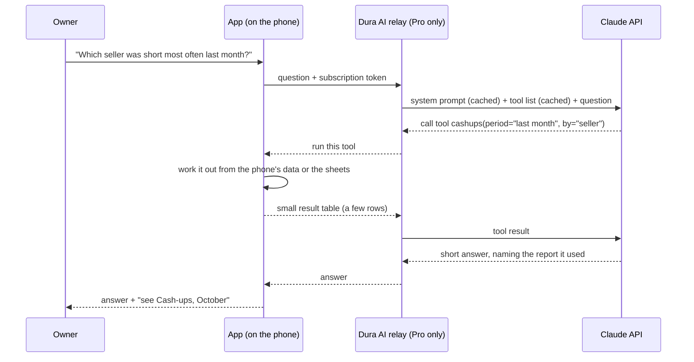

# "Ask Dura": the future AI assistant

28 October 2026. **A plan for later, not for now.** It's a paid, optional
feature. Everyone keeps the free way: `11-talk-to-your-data.md` and any AI
they like.

## What it is

- A chat screen in the app. It shows **ready-made questions** as tappable
  chips (from `11`: "What did we sell yesterday?", "What's running out?",
  "Who owes us?"), and the owner can type their own.
- **It only answers about this business and Dura.** It answers questions
  about the shop's data, and how to use Dura. Anything else gets a short,
  polite "I can only help with your shop and Dura", with no answer attempted.
- **Owner and manager only** (by role), behind the owner's PIN setting. It
  never answers a seller about other sellers.

## Free, do-it-yourself, and paid

| Tier | What | Cost to Dura |
|---|---|---|
| **Free, always** | The guide (`11`), plus two buttons: **Copy the AI prompt**, and **Export an AI pack** (the month's file and `My Shop` reports, as one workbook, with the guide). Use any AI | Nothing |
| **Bring your own key** | The chat screen, with the owner's own Claude API key (stored in Android Keystore). Requests go straight from the phone; nothing passes through Dura | Nothing |
| **Ask Dura Pro** (paid) | The chat with no key needed, plus a weekly "how the shop did" message | Model costs, a small relay, and store fees |

The bring-your-own-key tier comes first. It proves the tools, the prompts and
the guardrails at no cost to Dura, before anyone is charged.

## How it works: the phone does the counting, the model explains

- **Tools, not raw files.** The model gets a fixed set of tools that the
  **app** runs against the shop's own data. Each returns a small, summarised
  table:
  - `sales_summary(period, by)`;
  - `top_products(period, n)`;
  - `stock_status(location)`;
  - `balances(kind)`;
  - `cashups(period, by)`;
  - `vat_summary(period)`;
  - `profit(period)`;
  - `activity(period, action)`;
  - `how_to(topic)`, for Dura help from the docs.

  The numbers come from the app, so they're right. The model chooses the
  tool and explains the result.
- **The tools are the same code as the reports.** One query layer serves the
  home-screen cards, the Reports tab, the ready-made questions, and the AI.
- **The ready-made questions don't need the model.** A tap on a chip runs its
  tool and fills a written template ("You sold USD 412 and ZWG 3,150
  yesterday; the Main till was 1.00 short"). That's free, instant, and works
  offline. The model is used only for typed questions, and for "explain
  why".
- **Staying on topic** works in three layers:
  1. a system prompt that limits it to the shop and Dura;
  2. tools that can only return this shop's data;
  3. a cheap first check that turns away off-topic questions before the main
     model is called.

  Text from the sheets (customer names, notes) is treated as data, never as
  instructions.
- **The relay** is a small serverless function (e.g. Cloudflare Workers),
  and it's the only Dura-run server.
  - It holds Dura's API key and checks the subscription.
  - It limits each shop's usage, and passes requests through.
  - **It stores no conversations and no business data.**
  - This is a deliberate, stated exception to "no vendor cloud", for paid AI
    only. The free and bring-your-own-key tiers don't use it.
- **Privacy:**
  - Explain on an opt-in screen exactly what's sent: the question, and the
    small tool results.
  - Customer names and numbers are sent only when the question needs them.
  - Choose and state the model provider's data-retention terms (Anthropic's
    API doesn't train on API data by default; check the current terms and
    retention options), and mention Zimbabwe's Cyber and Data Protection Act
    in the notice.

## Keeping costs low

Prices are Anthropic's current list prices per million tokens. Check them
again before launch.

| Model | Input | Output | Cache read | Use |
|---|---|---|---|---|
| Claude Opus 5.5 (`claude-opus-5-5`) | $4.00 | $20.00 | $0.20 | The quality reference: run the eval with it first, at low effort |
| Claude Sonnet 5.5 (`claude-sonnet-5-5`) | $2.00 | $10.00 | $0.20 | Likely main model for typed questions, if the eval shows it's good enough |
| Claude Haiku 5.5 (`claude-haiku-5-5`) | $0.10 | $0.50 | — | The off-topic check, simple lookups, the weekly message |

**A typical typed question** takes two model turns: one picks a tool, one
answers. Assume:

- about 3,000 tokens of cached system prompt and tool list;
- about 2,500 fresh tokens (the question, the tool call, a small result);
- about 550 output tokens.

| Model | Rough cost per question | 300 questions a month |
|---|---|---|
| Sonnet 5.5 | about $0.013 | about $3.90 |
| Haiku 5.5 | about $0.001 | about $0.30 |
| Opus 5.5 | about $0.025 | about $7.50 |

These are estimates. Thinking tokens, retries and longer chats add to them,
so log the real usage from day one and judge by cost per answered question.

**What keeps the cost down, biggest first:**

1. **Chips answered without the model.** If most use is tapping the
   ready-made questions, most use costs nothing.
2. **Small tool results:** a 10-row summary, never a month of raw rows.
3. **Prompt caching.** Keep the system prompt and tool list exactly the same
   from request to request, so they're read from cache (about a tenth of the
   input price).
4. **Use the cheapest model that passes the eval.** Build an evaluation set
   of about 100 real owner questions, with known answers, from the sample
   shop (`samples/`). It's already a realistic shop with known numbers. Run
   Opus 5.5 at low effort, Sonnet 5.5 and Haiku 5.5 against it, and pick by
   accuracy, then cost.
5. **Batch the weekly message.** The weekly "how the shop did" message isn't
   urgent, so it goes through the Batch API at half price, overnight.
6. **Short answers by design:** the prompt asks for short, plain answers,
   with a sensible output cap.
7. **Quotas:** a monthly question allowance per shop. A repeated identical
   question the same day gets the same answer, without a second call.

## Making money from it

- **Price per shop, not per phone**, in USD:
  - **Pro:** about **$3 a month**, or $30 a year, for 300 typed questions a
    month plus the weekly message;
  - **Business:** about **$8 a month**, for 1,000 questions, branch
    comparisons and a monthly accountant pack.

  At the Sonnet estimate, a fully used Pro plan costs about $4 in tokens.
  Most shops will use far less, and chips are free. Still, set the price
  after the eval, and after measuring real use in the bring-your-own-key
  tier.
- **Annual plans first:** cheaper for the shop, less churn, cash up front.
- **Bundle it with consulting.** Setup and migration clients get Pro free
  for 3 months; they're the likeliest to keep paying.
- **Consultants and agents** can resell Pro to the shops they set up, for a
  commission.
- **Use it for your own work too.** The same tools help you map a client's
  old data during migration (`12`), cutting your consulting time. That is
  revenue as well.
- **How shops pay:**
  - **Inside a Play Store app, Google Play's payment rules apply to digital
    subscriptions.** Plan for Google Play Billing in the Play build, and
    check Google's current policy and fees for Zimbabwe before launch.
  - Plans sold as part of a consulting contract (an invoice to the business)
    can be activated on the shop's account.
  - Confirm how that sits with Play's rules before relying on it.

## Order of work (after the core app is out)

| Step | What | Cost to you |
|---|---|---|
| A0 | **Copy the AI prompt** and **Export an AI pack** buttons, using `11` | Nothing |
| A1 | The query layer (the tools), shared with home-screen cards and reports; the ready-made questions as free templates | Nothing |
| A2 | The eval: about 100 questions with known answers from the sample shop; compare the three models | A few dollars of API use |
| A3 | The bring-your-own-key chat, with the guardrails and the off-topic check | Nothing |
| A4 | The relay, subscriptions, quotas, and the privacy screen: **Ask Dura Pro** | A small relay bill, plus tokens |
| A5 | The weekly message through the Batch API; the Business plan | Tokens at half price |

**Numbers to watch:**

- cost per answered question;
- the share of questions answered by free chips;
- the share turned away as off-topic;
- conversion from free to Pro;
- monthly cancellations.
