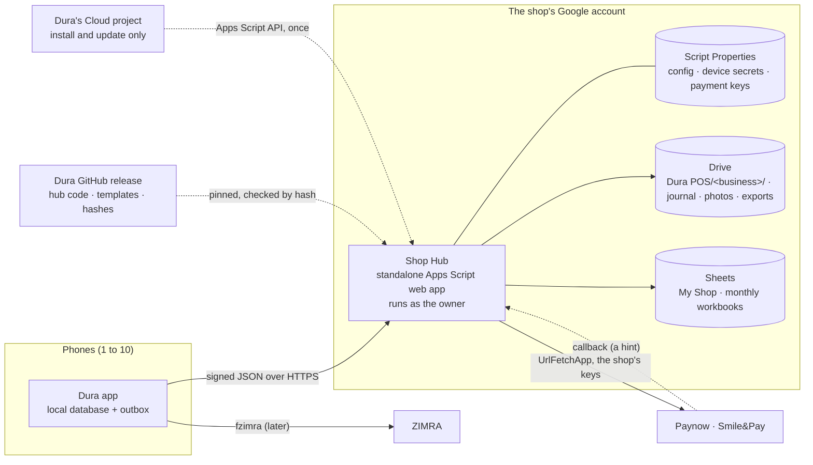

# The Apps Script route: the shop's account carries everything

3 November 2026. A research note, not yet a decision. It answers one question:
**can every request for a shop's records run on the shop's own Google account,
with Dura's Google Cloud project used only once, to install the Shop Hub?** It
explains how the hub would be installed, how it would find and manage the
shop's files, how phones pair by QR code, and how payments fit.

If adopted, decision 0005 would replace parts of decision 0003. Points marked
**spike** need a prototype before they're relied on.

## 1. The answer

Yes.

- The phone talks only to the shop's own Apps Script web app, the **Shop
  Hub**.
- The hub runs as the owner. Every Drive, Sheets and outside call it makes
  counts against the owner's account. API use inside a script goes to that
  script's default Cloud project, which Google creates and manages
  automatically.
- Dura's Google Cloud project is used once, when the owner installs the hub,
  and again only when they update it. That's a handful of requests per shop,
  well inside the free limits.
- After install, no phone holds a Google token. Phones hold a pairing secret
  that works only with that shop's hub.

| | Direct REST (decision 0003 today) | Apps Script route |
|---|---|---|
| Who the record requests count against | Dura's project, shared by every shop | The shop's own account |
| Billing exposure if Google charges for over-quota use | Dura's billing account | None for Dura |
| Google token on every phone | Yes | No; only during install, on the owner's phone |
| Hub needed | Only for payments and scheduled jobs | Always, for anything that reaches Drive |
| Selling offline | Unchanged | Unchanged |
| Speed of an upload | Fast | Slower; a cold start takes a second or two. Hidden behind the phone's queue |

## 2. What runs where



| Part | Runs on | Counts against |
|---|---|---|
| Selling, the outbox, receipts, fiscal signing | The phone | Nobody |
| Uploads, file creation, Sheets views, photos, exports | The hub | The shop's account |
| Payments and provider callbacks | The hub | The shop's account |
| Scheduled jobs: the next month's file, the nightly check, the day-end summary | The hub's time triggers | The shop's account |
| Installing and updating the hub | The owner's phone, through Dura's OAuth client | Dura's project, a few requests per shop |
| ZIMRA | The phone (fzimra) | Nobody; never the hub |

## 3. Installing the hub

### Option A: from the app (recommended)

The owner does this once, on their own phone, in about five minutes.

1. **Turn on the Apps Script API for their account.** The app opens Google's
   Apps Script settings page, and the owner flips the "Google Apps Script API"
   switch.
   - This is the one manual step, and Google requires it before any tool can
     create scripts in someone's account.
2. **Sign in with Google, once.** The app asks for two permissions:
   - `script.projects`, to create the project and its code;
   - `script.deployments`, to publish it as a web app.

   These permissions belong to Dura's OAuth client, in Dura's project.
3. **The app creates the hub in the owner's account,** through the Apps
   Script API:
   - create a **standalone** script project (`projects.create`), so it isn't
     bound to a spreadsheet anyone else could open;
   - upload the pinned hub code (`projects.updateContent`), with a one-time
     install token's hash baked in (§5);
   - create a version, then a web app deployment that runs as the owner and
     accepts requests without a Google sign-in (the hub checks every request
     itself).
4. **The owner approves the hub's own permissions.** The app opens the hub's
   address in the browser. Google shows the script's consent screen, which
   lists the hub's scopes (§6).
   - Google may show "Google hasn't verified this app" for a script the owner
     owns. The guide shows exactly what to tap. **Spike:** screenshot this on
     a fresh Gmail account.
5. **The app pairs itself as the owner's phone** using the install token
   (§5). It then forgets its Google token.
6. **The hub sets itself up:**
   - creates the `Dura POS/<business>/` folder, `My Shop` and this month's
     workbook from the templates (§7);
   - installs its time triggers;
   - writes its file registry.

**Cost to Dura:** about four Apps Script API calls per install, and the same
per update. No billing account is needed. The `script.projects` and
`script.deployments` scopes are sensitive, so Dura's OAuth client must pass
Google's app verification. That's free, but it needs a homepage, a privacy
policy and a short demo video. Apply early.

### Option B: copy a template (fallback, or for a consulting setup)

1. The owner opens a "Make a copy" link to the hub template. The copy carries
   the script.
2. They open it and authorise it.
3. They deploy it as a web app, either by hand (about six clicks in the
   editor) or by running a setup function. With the Apps Script API switch on,
   that function deploys the hub itself (§10).

Option B needs **a computer, or Chrome in desktop mode.** Custom menus and
sidebars don't appear in the Google Sheets phone app, and many vendors only
have a phone. That's why Option A is the main route.

## 4. One private hub, many shareable files

- **The hub is standalone and never shared.**
  - Anyone who can edit a script can read its Script Properties, which hold
    device secrets and payment keys.
  - A script bound to `My Shop` would expose those to anyone the owner gives
    edit access to `My Shop`, such as an accountant.
- **`My Shop` and the monthly workbooks stay ordinary files.** The owner can
  share them with an accountant without exposing any secret.
- **The owner should turn on 2-Step Verification.** The owner's Google account
  is the hub's root of trust, and the setup checklist says so.

## 5. Pairing phones with a QR code

**The first phone (the owner's), during install:**

1. The app generates a random 128-bit install token.
2. It bakes only the token's SHA-256 hash into the hub code it uploads,
   together with the install time.
3. It sends `pair` with the token. The hub accepts it only if:
   - no device is paired yet;
   - it's within 15 minutes of install;
   - the token hasn't been used before.
4. The hub then marks the token as used. The hash in the code reveals nothing.

**Every later phone:**

1. On the owner's phone: **Phones → Add a phone.** The owner's phone asks the
   hub for a pairing code, authenticated with its own device secret and the
   owner's PIN.
2. The hub makes a 128-bit code and keeps only its hash, with a 10-minute
   expiry and a single use. It returns the code.
3. The owner's phone shows a QR code containing
   `{"v":1,"hub":"<web app address>","business":"<id>","code":"<pairing code>"}`.
4. The new phone scans it and sends
   `{"action":"pair","code":…,"name":"Back counter"}`.
5. The hub checks the code and assigns a device ID (`P2`). It generates a
   256-bit device secret, stores it in Script Properties under `dev:P2`, and
   returns it **once**.
6. The new phone keeps the secret in Android Keystore-backed storage.

**Every request after that** is signed:

```json
{"v":1,"device":"P2","ts":1793700000,"nonce":"9f2c…","action":"journal.put",
 "body":{…},"sig":"<HMAC-SHA256 of v, device, ts, nonce, action and body>"}
```

The hub rejects a request if:

- the signature doesn't match;
- `ts` is more than 5 minutes out;
- the nonce has been seen in the last 10 minutes (kept in `CacheService`);
- the device has been revoked.

The signature goes in the body because a web app can't read request headers.
The app follows the redirect Google sends with every web app reply.

**Revoking a phone:** Phones → Remove. The hub deletes `dev:P2`, so the next
request from that phone fails.

**A lost phone:**

- It can't reach Drive, because it never held a Google token.
- Its sales already uploaded are safe.
- Anything never uploaded is lost with it.

**Why not show the QR in the spreadsheet?** Two reasons:

- the Sheets phone app can't show the hub's menus;
- a QR generated by an outside image service would send the code to a third
  party.

The owner's phone draws the QR itself.

## 6. The hub's permissions

> **Update, 5 November 2026 (as built):** the `spreadsheets` scope is dropped.
> The Sheets API's `values.batchUpdate` accepts `drive.file`, so the hub can
> write its own files through the Sheets advanced service without access to the
> owner's other spreadsheets. Spike 2 must confirm this on a real account.

| Scope | Why |
|---|---|
| `drive.file` | Create folders, files, photos and exports, and write Sheets through the Sheets advanced service. It reaches only files the hub created |
| `script.external_request` | Fetch templates and updates; call payment providers |
| `script.scriptapp` | Install time triggers |
| `script.projects`, `script.deployments` | Optional: only if the hub updates itself (§10) |

Use the Drive advanced service (the Drive API through the script's default
project) rather than `DriveApp`, because `DriveApp` asks for full Drive
access. **Spike:** confirm this combination of scopes works end to end.

## 7. Creating and moving files in the shop's account

**Templates:**

1. The Python generator produces the `.xlsx` templates.
2. Each Dura release publishes them, with their SHA-256 hashes.
3. The hub's code pins the release and the hashes.
4. To make a file, the hub fetches the template (`UrlFetchApp`) and checks its
   hash (`Utilities.computeDigest`).
5. It creates the file through the Drive advanced service with the Google
   Sheets mime type, which converts it. The result is a file the hub created,
   in the shop's folder.

**Spike:** check that conversion keeps the dropdowns, colour rules, formulas
and charts.

**When files are made:**

| File | Made by | When |
|---|---|---|
| `Dura POS/<business>/` folder, `My Shop` | The hub | At install |
| This month's workbook | The hub | At install, then each month |
| Next month's workbook | A daily trigger | From the 25th, until it exists |
| Next year's folder | A daily trigger | In December |
| A month's workbook needed for a late sale | The hub | On demand, under a lock, if missing |
| Product photos | The phone uploads (about 150 KB, base64); the hub saves | When a photo is taken |
| Supplier invoice photos | Same | When a purchase is recorded |
| Exports (Excel, CSV) | The hub | When the owner asks; saved to `Exports/` or returned to the phone |
| `(TEST)` folder | The hub | The first time test mode is used. Its own registry, `T-` IDs |

**Moving an existing business onto Dura:**

- With `drive.file`, the hub can't read the owner's old files, and that's
  deliberate.
- Instead, the hub creates an **Import** workbook. The owner (or a
  consultant) pastes or uploads the old data into it, then the dry run and
  import from note 12 §8 apply.
- The old files are left as they are.

**Archiving:**

- At year end, the hub moves that year's workbooks and journal into the year
  folder. `drive.file` allows moving files the hub created.
- It writes opening positions into the new year's files.
- It deletes nothing (decision 0003).

## 8. How the hub knows the business's files

> **Update, 3 November 2026 (as built):** the registry lives in Script
> Properties, as `file:<key>` entries holding Drive IDs, not in a private
> workbook. Each request already reads Script Properties once, so lookups cost
> no extra quota and no Sheets read. A readable `Files` tab in `My Shop` can
> mirror it later.

The hub never looks a file up by name. It uses three layers:

1. **Script Properties (the root):** a few small values.
   - `businessId`, `rootFolderId`, `registryId`, `layoutVersion`, `timeZone`;
   - per-device sequence counters;
   - device secrets and payment keys.

   This store holds 500 KB at most, and 9 KB per value, so it holds only
   these.
2. **The registry:** a `Files` tab in a private `Dura Hub` workbook, mirrored
   read-only into `My Shop` so people can read it. One row per file:

   | Key | Kind | Period | File ID | Layout | Status |
   |---|---|---|---|---|---|
   | myshop | My Shop | – | 1AbC… | 1 | OK |
   | month:2026-11 | Monthly | 2026-11 | 1XyZ… | 1 | OK |
   | journal:2026-11 | Journal folder | 2026-11 | 1JkL… | – | OK |

3. **The cache:** registry lookups are cached in `CacheService` for 6 hours,
   and in memory for the length of a request.

**Routing:** an event's date, in the business time zone, gives its period. The
period gives the registry key, which gives the file ID. A late sale from
October goes to October's file, whenever it arrives.

**Self-healing:** if a file ID no longer opens (trashed or deleted), the hub:

- marks it `Missing`;
- tells the owner's phone;
- offers to rebuild that view from the journal.

`business.json` in the root folder holds the same root IDs, so a reinstalled
hub can find everything again.

## 9. Sync: journal first, views after

1. **The phone seals a batch:**
   - its device ID and the next sequence number (`P2-000124`);
   - up to a few hundred events;
   - a SHA-256 of the content;
   - gzipped, then base64 encoded.
2. **The hub checks** the signature, then the sequence number:
   - **next expected:** it writes the batch as one JSON file under
     `Journal/2026/11/P2-000124.json`, raises the device's high-water mark,
     and replies `accepted through 124`;
   - **already seen:** it replies the same acknowledgement again. A lost
     reply is harmless, because the phone retries with the same batch;
   - **a gap:** it replies `need 123`.

   Keeping one high-water number per device makes duplicate checks constant
   in size.
3. **Views come next.** A projection step appends the new rows to the right
   monthly tabs, one `setValues` per tab. It runs either:
   - at the end of the request, if it's small;
   - or from a 5-minute trigger.

   Each tab keeps its own high-water mark, so the step is resumable and never
   double-counts.
4. **Writes are serialised** with `LockService`. With 1 to 10 phones, waits
   are short.
5. **Master data comes back on the same reply.** Products, prices, rates and
   staff changed since the phone's last version are returned, so a sync is one
   round trip.

The phone shows "uploaded" only after `accepted`, and "in your sheets" only
after the projection catches up.

## 10. Updating the hub

- **From the app (Option A):**
  1. The owner taps *Update hub*.
  2. The app signs in once, uploads the new pinned code, creates a version,
     and **updates the existing deployment**. The address never changes, so
     paired phones keep working.
  3. Rollback means pointing the deployment back at the previous version.
- **Self-update (optional):**
  1. The hub fetches a release manifest and checks its hash against the
     manifest pinned in its current code.
  2. It updates its own content and deployment through the Apps Script API,
     with its own token (`ScriptApp.getOAuthToken`). This needs the
     `script.projects` and `script.deployments` scopes, and the Apps Script
     API switch.
  3. The owner approves each update from their phone; nothing updates
     silently.
- **Protocol versions:** every request carries `v`, and the app supports
  older hubs for a long time.

## 11. Payments through the hub

- **Keys:** the shop's Paynow or Smile&Pay keys, live and sandbox, go into
  Script Properties from the owner's phone over a signed request.
  - They're never in a sheet, a log or an export.
  - Phones never hold them.
- **Starting a payment:**
  1. The phone sends `pay.start` with the amount as a decimal string, the
     currency, the payer's number and a reference.
  2. The hub calls the provider with `UrlFetchApp`, records the reference
     once, and returns `pending`.
- **Checking:** the phone polls `pay.check`, and the hub polls the provider. A
  payment is marked paid **only after the provider's status check confirms
  it.**
- **Callbacks:** the provider posts to the hub's address, e.g.
  `…/exec?cb=paynow`.
  - The hub verifies the provider's hash, logs the callback to Payment
    Callbacks, and treats it as a hint.
  - Google answers every web app POST with a redirect, but the hub's code has
    already run by then. **Spike:** confirm Paynow accepts this.
- **Adapters:** the provider-specific code for each client sits behind one
  contract inside the hub, as in note 10 §5.

## 12. Security model

| Risk | Mitigation |
|---|---|
| A lost or stolen phone | No Google token on it. Revoke its device secret; the outbox loss is limited to unsynced sales |
| A cashier reads the owner's Drive | Staff phones never sign in to Google |
| An accountant sees payment keys | The hub is a separate, private, standalone project; secrets live only in its Script Properties |
| Someone finds the hub's address | The address alone does nothing: every request needs a valid device signature, a fresh timestamp and a new nonce |
| A replayed request | The timestamp window, the nonce cache, and per-device sequence numbers |
| A forged payment callback | Provider hash check; paid only after a status check |
| A tampered update or template | Pinned release, SHA-256 checked before use; updates approved by the owner |
| The owner's account taken over | Out of Dura's reach. Require 2-Step Verification in the setup checklist |
| Secrets in logs | The hub logs IDs and outcomes only, never bodies, keys or secrets |

## 13. Keeping the hub fast and inside its limits

Consumer Gmail limits ([Google's quota page](https://developers.google.com/apps-script/guides/services/quotas)):

| Limit | Gmail | Workspace |
|---|---|---|
| Simultaneous executions | 30 per user | 30 per user |
| Runtime | 6 minutes per execution | 6 minutes |
| Time-trigger runtime | 90 minutes a day | 6 hours a day |
| URL Fetch calls | 20,000 a day | 100,000 a day |
| Properties reads and writes | 50,000 a day | 500,000 a day |
| Properties storage | 500 KB; 9 KB a value | Same |
| Spreadsheets created | 250 a day | 3,200 a day |
| Email recipients | 100 a day | 1,500 a day |

**A busy example:** 10 phones syncing every 15 minutes for 12 hours.

- That's 480 sync requests a day, plus around 200 for payments and master
  data.
- Requests to the web app don't use the 90-minute trigger budget.
- Triggers: a 5-minute projection taking about 10 seconds, plus a few daily
  jobs, comes to about 50 minutes a day. That's the tightest limit, so
  project inline when a batch is small and keep triggers short.
- Property writes are about two per batch, so roughly 1,000 a day.

**Techniques:**

- One `getValues` or `setValues` per tab, never cell by cell.
- Track the next free row, not `getLastRow` on every call.
- Formatting through one Sheets `batchUpdate`.
- `LockService` only around writes.
- Gzipped batches, to save the shop's mobile data.
- Cached registry lookups.
- Long jobs, such as the year end, split into resumable steps under 5
  minutes, chained by triggers.
- No custom functions in the sheets.

## 14. What this would change

- **Decision 0003, point 4:** phones no longer upload directly through the
  Drive and Sheets APIs. Everything goes through the hub.
- **Decision 0003, point 5:** the hub is always the view writer. The handover
  between owner phone and hub goes away, which removes a hard part of the
  design.
- **CLAUDE.md:** "the Shop Hub is optional" becomes "the hub is needed for
  anything that reaches Drive". Selling offline still needs nothing.
- **Phones:** no Google Sign-In except the owner's install and updates.
- **Unchanged:**
  - sales complete on the phone;
  - the journal is the history and the Sheets are views;
  - templates come from the Python generator;
  - ZIMRA never touches the hub;
  - test mode stays separate.

## 15. Honest limits

- **Every shop needs the hub** before anything reaches Drive. A cash-only
  vendor can still sell offline from day one, and connect the hub later.
- **Apps Script sometimes fails briefly.** "Service invoked too many times"
  and timeouts happen. The phone's queue and idempotent batches absorb this,
  but sheets can lag.
- **The owner's account is the hub's lifeline.** If they revoke the hub's
  access or delete it, uploads pause until it's reinstalled. Selling carries
  on.
- **Google can change Apps Script quotas or consent screens.** Keep the hub's
  design within the Gmail limits with room to spare.
- **Install needs a few Google screens** that look unfamiliar to a first-time
  owner. That's the part to test with real vendors.

## 16. Spikes, in order

1. **Install on a fresh Gmail account:** run Option A end to end, and time
   it. Screenshot the Apps Script API switch, the "unverified" consent screen,
   and the deployment.
2. **The hub's scopes:** confirm `spreadsheets` plus `drive.file` with the
   Drive advanced service can create a folder, convert a template, and write
   rows.
3. **Template conversion:** convert the generated `My Shop.xlsx` and check its
   dropdowns, colour rules, formulas and charts in Sheets.
4. **Sync:** time a 200-event batch through the hub, cold and warm. Then test
   a lost reply and a retry; it must produce no duplicates.
5. **Paynow:** in the sandbox, test start, check, and a callback to a web app
   address with Google's redirect.
6. **Self-deploy and update:** confirm a script can update its own content and
   deployment with `ScriptApp.getOAuthToken`.
7. **Capacity:** run 10 phones' worth of traffic for a simulated day, and
   check the trigger minutes used.

## Sources

- [Apps Script quotas](https://developers.google.com/apps-script/guides/services/quotas)
- [Apps Script and Google Cloud projects](https://developers.google.com/apps-script/guides/cloud-platform-projects)
- [Content service and web app redirects](https://developers.google.com/apps-script/guides/content)
- [Apps Script API: enabling access](https://developers.google.com/apps-script/api/how-tos/enable)
- [Apps Script API: deployments](https://developers.google.com/apps-script/api/reference/rest/v1/projects.deployments)
- [Sheets API usage limits](https://developers.google.com/workspace/sheets/api/limits)
- [Drive API usage limits](https://developers.google.com/workspace/drive/api/guides/limits)
